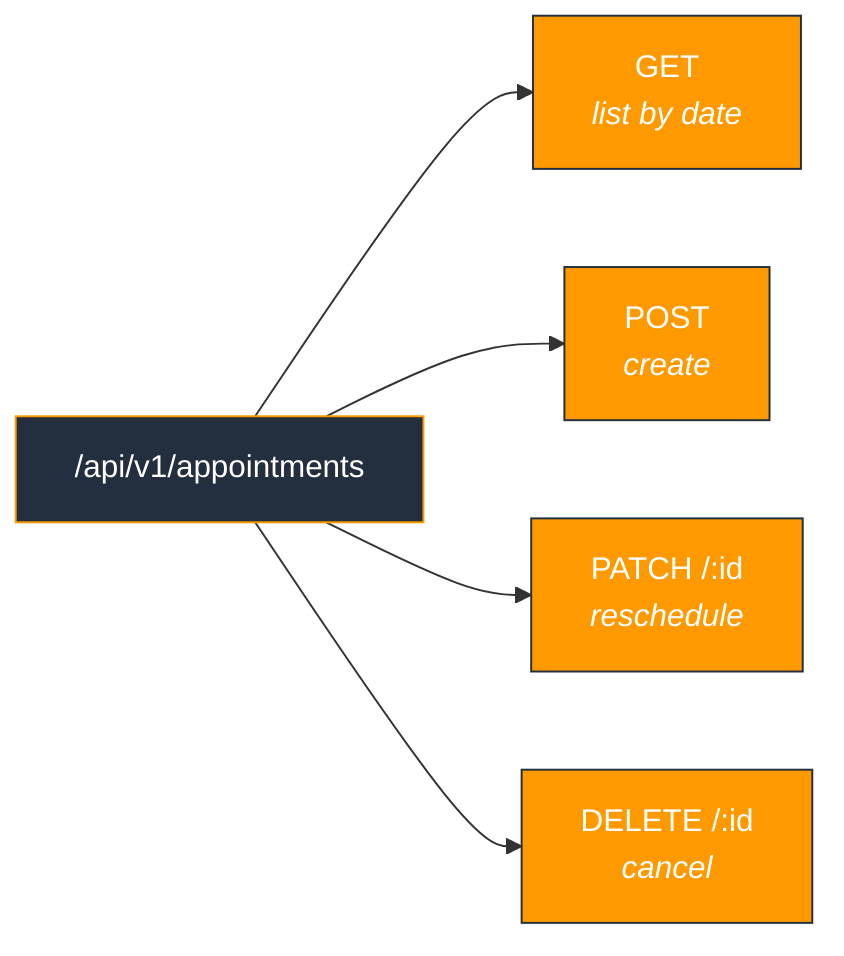
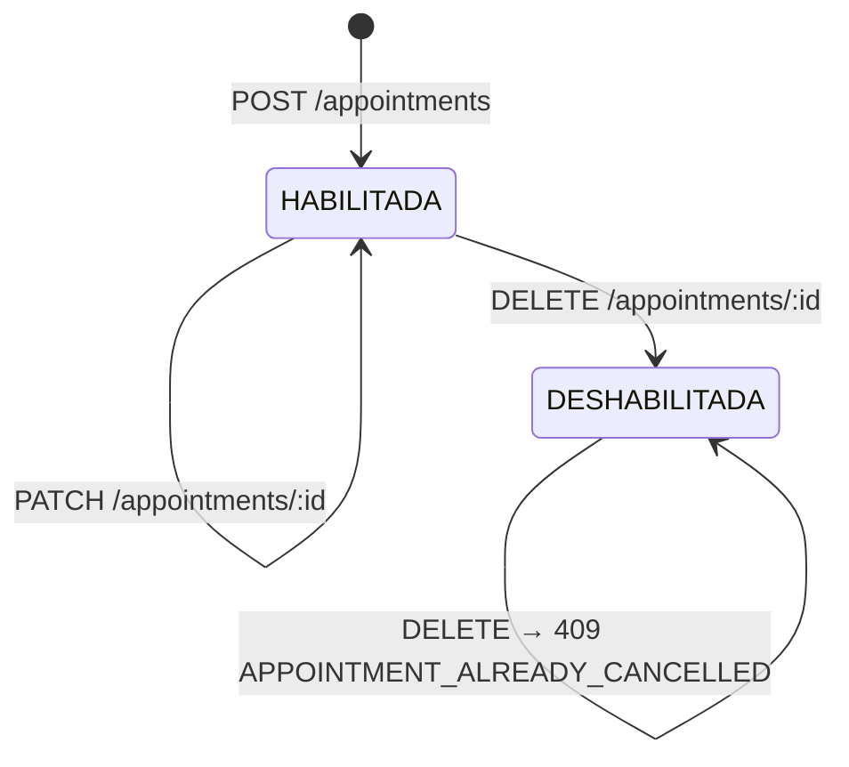

# API endpoints

Base path: `/api/v1`.

- Live endpoint: <https://5sg14jfok6.execute-api.us-east-1.amazonaws.com>
- Interactive documentation (Scalar):
  <https://5sg14jfok6.execute-api.us-east-1.amazonaws.com/api/docs>
- OpenAPI document:
  <https://5sg14jfok6.execute-api.us-east-1.amazonaws.com/api/openapi.json>



---

## 1. List the appointments of a date

```http
GET /api/v1/appointments?date=2026-01-15
```

| Parameter | Type | Required | Description |
| --- | --- | --- | --- |
| `date` | `YYYY-MM-DD` | yes | The day to list, in the local time of the shop |

**200 OK**

```json
{
  "items": [
    {
      "id": "33333333-3333-4333-8333-333333333333",
      "clientId": "11111111-1111-4111-8111-111111111111",
      "vehicleId": "22222222-2222-4222-8222-222222222222",
      "date": "2026-01-15",
      "time": "10:00",
      "status": "HABILITADA",
      "comments": "First visit",
      "createdAt": "2026-11-19T23:12:11.812Z",
      "updatedAt": "2026-11-19T23:12:11.812Z"
    }
  ]
}
```

**400 Bad Request** — the date is missing or is not a valid ISO date.

```bash
curl "https://5sg14jfok6.execute-api.us-east-1.amazonaws.com/api/v1/appointments?date=2026-01-15"
```

---

## 2. Create an appointment

```http
POST /api/v1/appointments
Content-Type: application/json
```

| Field | Type | Required | Description |
| --- | --- | --- | --- |
| `clientId` | UUID | yes | The client that books the appointment |
| `vehicleId` | UUID | yes | The vehicle to be repaired |
| `date` | `YYYY-MM-DD` | yes | The day of the appointment |
| `time` | `HH:mm` | yes | The start time, local time of the shop |
| `comments` | string (≤ 500) | no | Free text |

**201 Created**

```json
{
  "id": "490eebdf-eb8d-4831-aaeb-3d0a12f0108c",
  "clientId": "11111111-1111-4111-8111-111111111111",
  "vehicleId": "22222222-2222-4222-8222-222222222222",
  "date": "2026-03-10",
  "time": "09:00",
  "status": "HABILITADA",
  "comments": "Front brake pads",
  "createdAt": "2026-11-19T23:12:18.650Z",
  "updatedAt": "2026-11-19T23:12:18.650Z"
}
```

**409 Conflict** — the slot is already taken.

```json
{
  "type": "https://api.alten.com/problems/slot-not-available",
  "title": "The time slot is already taken",
  "status": 409,
  "detail": "The requested time slot is already taken.",
  "instance": "/api/v1/appointments",
  "code": "SLOT_NOT_AVAILABLE",
  "context": { "date": "2026-03-10", "time": "09:00" }
}
```

```bash
curl -X POST "https://5sg14jfok6.execute-api.us-east-1.amazonaws.com/api/v1/appointments" \
  -H 'Content-Type: application/json' \
  -d '{
        "clientId": "11111111-1111-4111-8111-111111111111",
        "vehicleId": "22222222-2222-4222-8222-222222222222",
        "date": "2026-03-10",
        "time": "09:00",
        "comments": "Front brake pads"
      }'
```

---

## 3. Reschedule an appointment

```http
PATCH /api/v1/appointments/{id}
Content-Type: application/json
```

| Field | Type | Required | Description |
| --- | --- | --- | --- |
| `date` | `YYYY-MM-DD` | one of the two | The new day |
| `time` | `HH:mm` | one of the two | The new start time |

At least one of `date` or `time` has to be sent.

**200 OK** — the updated appointment.

```json
{
  "id": "490eebdf-eb8d-4831-aaeb-3d0a12f0108c",
  "clientId": "11111111-1111-4111-8111-111111111111",
  "vehicleId": "22222222-2222-4222-8222-222222222222",
  "date": "2026-03-10",
  "time": "14:00",
  "status": "HABILITADA",
  "comments": "Front brake pads",
  "createdAt": "2026-11-19T23:12:18.650Z",
  "updatedAt": "2026-11-19T23:12:19.950Z"
}
```

| Error | When |
| --- | --- |
| `400 INVALID_PAYLOAD` | The id is not a UUID, or neither `date` nor `time` was sent |
| `404 APPOINTMENT_NOT_FOUND` | There is no appointment with that id |
| `409 SLOT_NOT_AVAILABLE` | The new slot is taken |
| `409 APPOINTMENT_ALREADY_CANCELLED` | The appointment was already cancelled |

```bash
curl -X PATCH "https://5sg14jfok6.execute-api.us-east-1.amazonaws.com/api/v1/appointments/490eebdf-eb8d-4831-aaeb-3d0a12f0108c" \
  -H 'Content-Type: application/json' \
  -d '{ "time": "14:00" }'
```

---

## 4. Cancel an appointment

```http
DELETE /api/v1/appointments/{id}
```

The appointment is **not deleted**: its status becomes `DESHABILITADA` and
`updatedAt` is refreshed, as the statement requires. The slot is released
immediately, because the exclusion constraint only applies to the enabled
appointments.

**200 OK** — the cancelled appointment.

```json
{
  "id": "490eebdf-eb8d-4831-aaeb-3d0a12f0108c",
  "clientId": "11111111-1111-4111-8111-111111111111",
  "vehicleId": "22222222-2222-4222-8222-222222222222",
  "date": "2026-03-10",
  "time": "14:00",
  "status": "DESHABILITADA",
  "comments": "Front brake pads",
  "createdAt": "2026-11-19T23:12:18.650Z",
  "updatedAt": "2026-11-19T23:12:19.950Z"
}
```

| Error | When |
| --- | --- |
| `400 INVALID_PAYLOAD` | The id is not a UUID |
| `404 APPOINTMENT_NOT_FOUND` | There is no appointment with that id |
| `409 APPOINTMENT_ALREADY_CANCELLED` | It was already cancelled |

```bash
curl -X DELETE "https://5sg14jfok6.execute-api.us-east-1.amazonaws.com/api/v1/appointments/490eebdf-eb8d-4831-aaeb-3d0a12f0108c"
```

---

## The lifecycle of an appointment



## Related documents

- [errors.md](errors.md) — the error catalogue.
- [openapi.md](openapi.md) — the OpenAPI document and Scalar.
