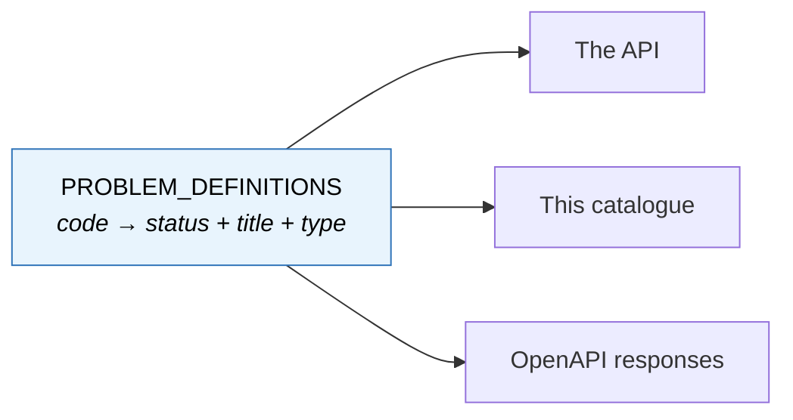
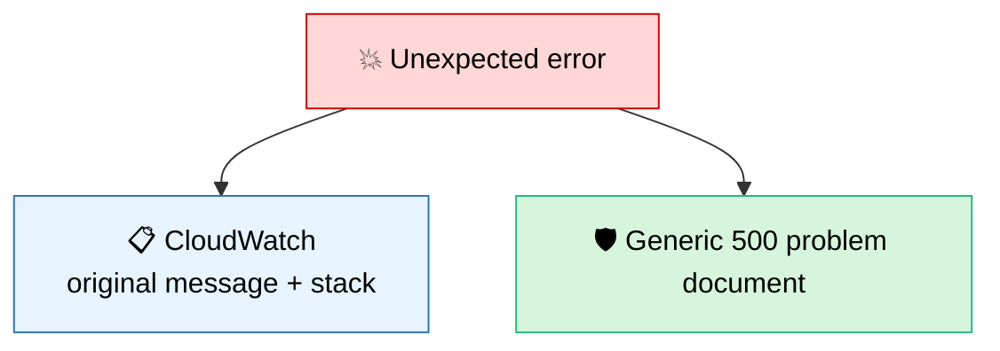
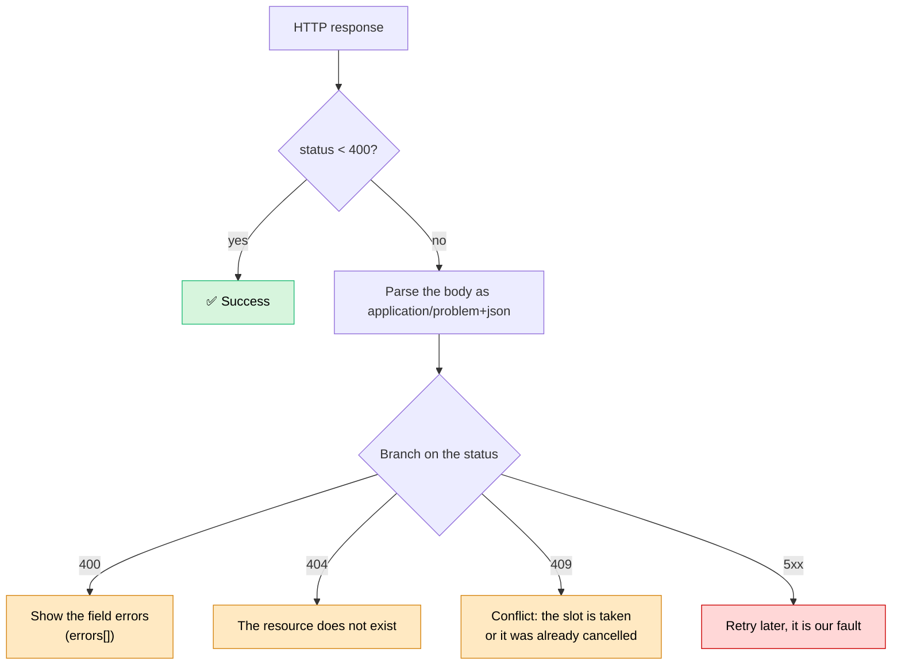

# Errors

Every error of the API is a **problem details** document, as defined by
[RFC 9457](https://www.rfc-editor.org/rfc/rfc9457), served with the content
type `application/problem+json`.

The rationale is in [ADR 0003](../decisions/0003-errors-rfc-9457.md).

## The document

```json
{
  "type": "https://api.alten.com/problems/slot-not-available",
  "title": "The time slot is already taken",
  "status": 409,
  "detail": "The requested time slot is already taken.",
  "instance": "/api/v1/appointments",
  "code": "SLOT_NOT_AVAILABLE",
  "errors": [{ "path": "date", "message": "Invalid ISO date" }],
  "context": { "date": "2026-03-10", "time": "09:00" }
}
```

| Member | Type | Presence | Description |
| --- | --- | --- | --- |
| `type` | URI | always | Identifies the kind of problem. It is an identifier: it does not have to resolve. |
| `title` | string | always | Short summary of the problem. Constant for a given `type`. |
| `status` | number | always | The HTTP status code, repeated in the body. |
| `detail` | string | always | Explanation of this particular occurrence. |
| `instance` | string | always | The URI of the request that failed. |
| `code` | string | always | Stable, machine readable code (extension). |
| `errors` | array | validation only | One entry per invalid field (extension). |
| `context` | object | when it helps | Domain data about the failure (extension). |

## The catalogue

| Status | Code | Title | When |
| --- | --- | --- | --- |
| 400 | `INVALID_PAYLOAD` | The request payload is not valid | The body, the query or the path parameter does not match the schema |
| 400 | `REQUEST_FAILED` | The request could not be processed | Any other HTTP level rejection (for example an unsupported method) |
| 404 | `NOT_FOUND` | The requested resource does not exist | The route does not exist |
| 404 | `APPOINTMENT_NOT_FOUND` | The appointment does not exist | The `{id}` does not match any appointment |
| 404 | `CLIENT_NOT_FOUND` | The client does not exist | Reserved for the client endpoints |
| 404 | `VEHICLE_NOT_FOUND` | The vehicle does not exist | Reserved for the vehicle endpoints |
| 409 | `SLOT_NOT_AVAILABLE` | The time slot is already taken | The slot is occupied, detected by the pre-check or by the exclusion constraint |
| 409 | `APPOINTMENT_ALREADY_CANCELLED` | The appointment is already cancelled | A cancelled appointment cannot be rescheduled or cancelled again |
| 500 | `INTERNAL_ERROR` | Internal server error | An unexpected failure. The details are logged, never returned. |
| 502 | `INVALID_UPSTREAM_RESPONSE` | The appointments service returned an invalid response | The answer of the service does not match the contract |
| 502 | `LAMBDA_INVOCATION_FAILED` | The appointments service could not be reached | The service could not be invoked |

The catalogue lives in a single file, `src/api/errors/problem-details.ts`, and
it is the only place where the status codes are decided.



## Examples

### 400 — invalid payload

```bash
curl -i -X POST "https://5sg14jfok6.execute-api.us-east-1.amazonaws.com/api/v1/appointments" \
  -H 'Content-Type: application/json' \
  -d '{ "clientId": "not-a-uuid", "date": "15-01-2026" }'
```

```json
{
  "type": "https://api.alten.com/problems/invalid-payload",
  "title": "The request payload is not valid",
  "status": 400,
  "detail": "The request payload is not valid.",
  "instance": "/api/v1/appointments",
  "code": "INVALID_PAYLOAD",
  "errors": [
    { "path": "clientId", "message": "Invalid input: expected string, received undefined" },
    { "path": "date", "message": "Invalid ISO date" }
  ]
}
```

### 404 — the route does not exist

```bash
curl -i "https://5sg14jfok6.execute-api.us-east-1.amazonaws.com/api/v1/unknown"
```

```json
{
  "type": "https://api.alten.com/problems/not-found",
  "title": "The requested resource does not exist",
  "status": 404,
  "detail": "Cannot GET /api/v1/unknown",
  "instance": "/api/v1/unknown",
  "code": "NOT_FOUND"
}
```

### 409 — the slot is taken

```json
{
  "type": "https://api.alten.com/problems/slot-not-available",
  "title": "The time slot is already taken",
  "status": 409,
  "detail": "The requested time slot is already taken.",
  "instance": "/api/v1/appointments",
  "code": "SLOT_NOT_AVAILABLE",
  "context": { "date": "2026-03-10", "time": "09:00" }
}
```

### 500 — unexpected failure

```json
{
  "type": "https://api.alten.com/problems/internal-error",
  "title": "Internal server error",
  "status": 500,
  "detail": "An unexpected error occurred while processing the request.",
  "instance": "/api/v1/appointments",
  "code": "INTERNAL_ERROR"
}
```

The internal message (a stack trace, a SQL error, the connection string) is
**never** part of the answer: it is written to the CloudWatch logs and the
client receives a generic document.



## How a client should read the errors



The `code` is the stable part to branch on; the `detail` is written for a
human and may change at any time.
