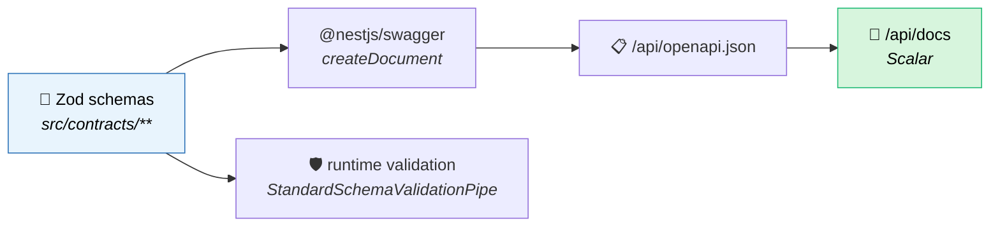
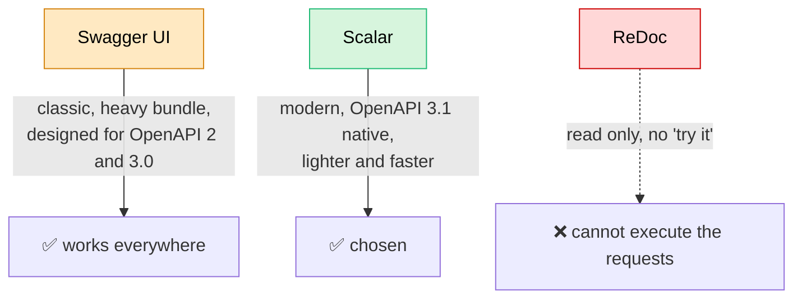
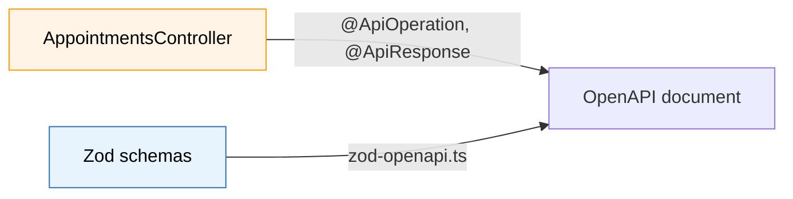

# OpenAPI and the interactive documentation

The API publishes its own contract, generated from the same Zod schemas that
validate the runtime traffic.

| Resource | URL |
| --- | --- |
| **Interactive documentation (Scalar)** | <https://5sg14jfok6.execute-api.us-east-1.amazonaws.com/api/docs> |
| **OpenAPI document (JSON)** | <https://5sg14jfok6.execute-api.us-east-1.amazonaws.com/api/openapi.json> |



## Why Scalar



- It is **OpenAPI 3.1** native, which is the version the document declares.
- The "Test request" button calls the **live** endpoint: the documentation is
  also a manual test console.
- It is lighter than the classic Swagger UI, which matters in a Lambda where
  every kilobyte is loaded on the cold start.
- `@scalar/nestjs-api-reference` mounts it with a single call and a single
  URL (`/api/docs`).

## What the document contains

| Section | Content |
| --- | --- |
| `paths` | The four endpoints, with the query, the parameters and the body |
| `responses` | The success responses **and** the error responses, declared as `application/problem+json` |
| `schemas` | The Zod schemas of the requests and the responses |
| `tags` | `appointments` |



The bridge between Zod and OpenAPI is `src/api/inbound/http/zod-openapi.ts`: it
converts a Zod schema into the JSON Schema fragment that the Swagger
decorators expect, so the document and the validation can never describe
different things.

## Errors in the document

The error responses are declared with the problem details schema, so the
documentation shows the exact body the client will receive:

```json
"409": {
  "description": "The time slot is already taken",
  "content": {
    "application/problem+json": {
      "schema": { "$ref": "#/components/schemas/ProblemDetails" }
    }
  }
}
```

## Local development

```bash
pnpm start:dev
```

- Documentation: <http://localhost:3000/api/docs>
- OpenAPI document: <http://localhost:3000/api/openapi.json>

## Related documents

- [endpoints.md](endpoints.md) — the endpoints with examples.
- [errors.md](errors.md) — the error catalogue.
- [ADR 0002](../decisions/0002-validation-with-zod.md) — why the schemas are
  the source of truth.
