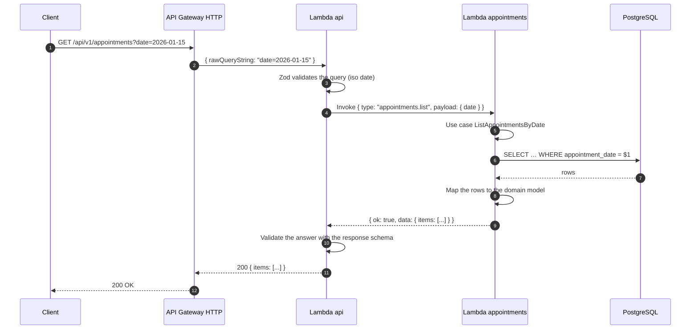
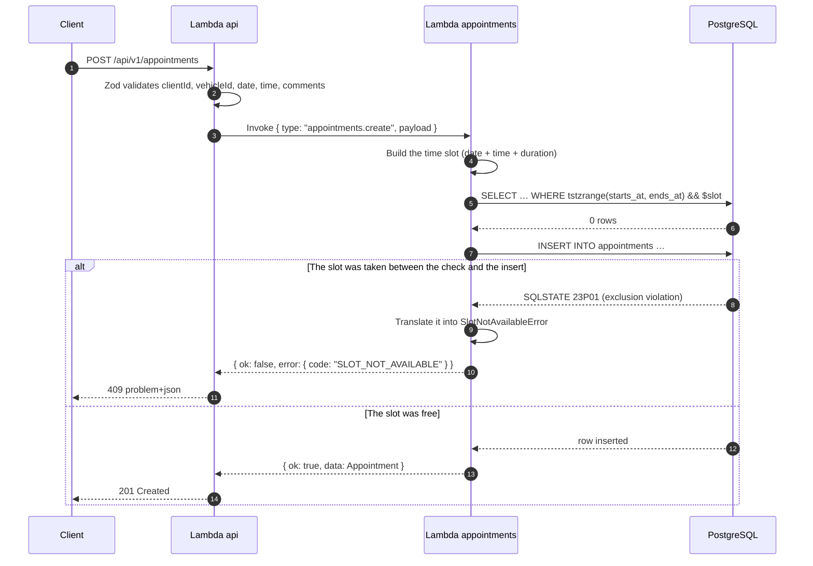
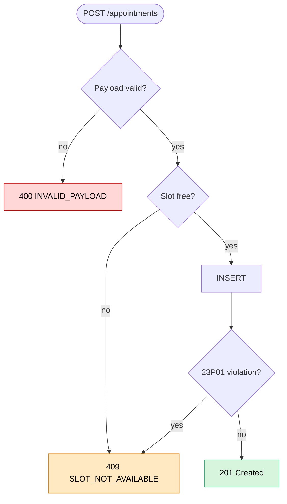
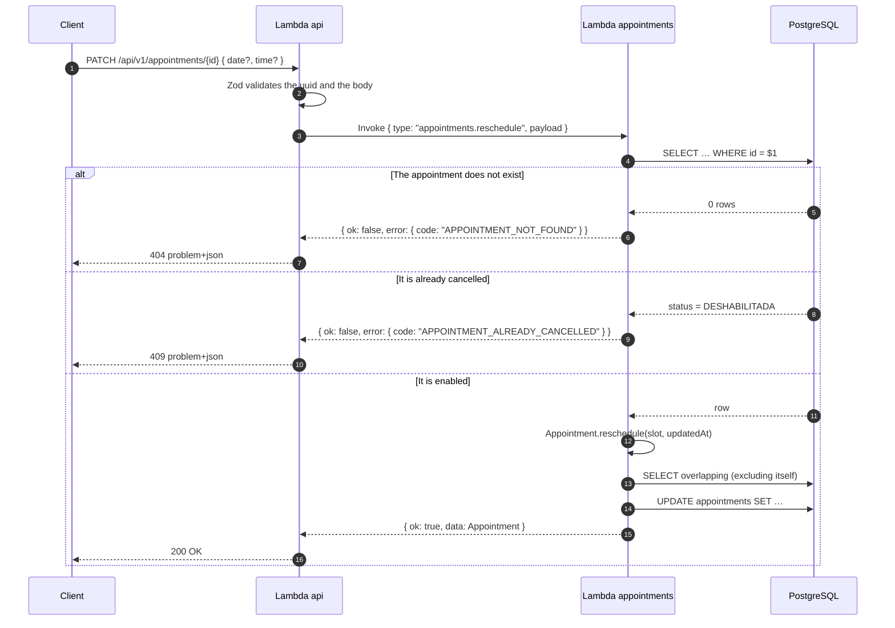
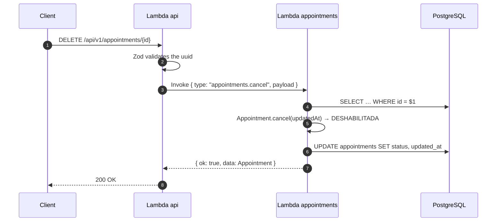
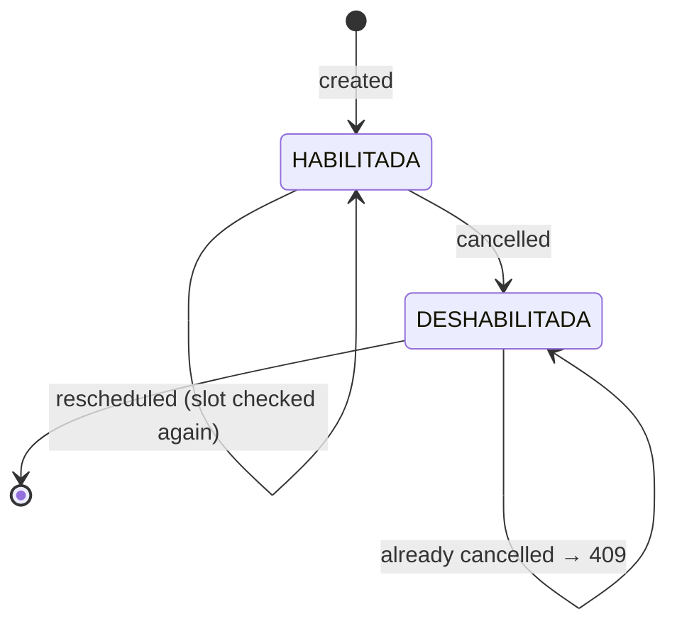
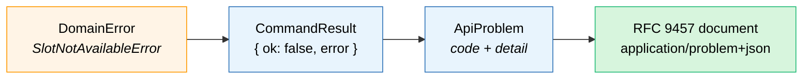
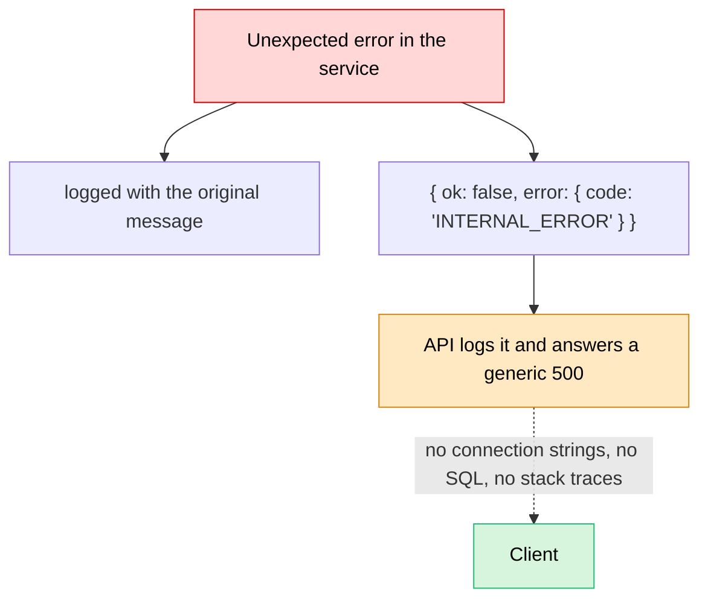
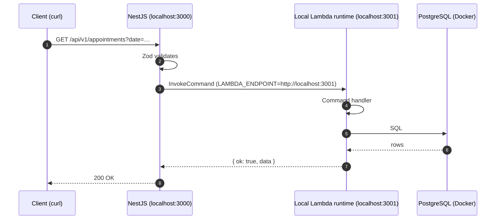

# Data flow

How a request travels from the client to PostgreSQL and back, and what
happens in each layer.

## 1. List the appointments of a date

## 2. Create an appointment (double booking check)

The pre-check is only an optimisation for a friendly error message. The
**real** guarantee is the exclusion constraint in PostgreSQL: two concurrent
bookings can never end up in the same slot, whichever order the transactions
reach the database.

## 3. Reschedule an appointment

## 4. Cancel an appointment

Cancelling does **not** delete the row: the statement requires the status to
change to `DESHABILITADA` and the update date to be refreshed. Because the
exclusion constraint is *partial* (`WHERE status = 'HABILITADA'`), the slot is
released immediately and can be booked again.

## 5. Error propagation

An error in the business layer is translated twice: first into the internal
`CommandResult` error, then into the public RFC 9457 document.

An unexpected failure never leaks internals: the service logs the original
error and answers `INTERNAL_ERROR`, and the API replaces the upstream detail
with a generic message before rendering it.

## 6. Local development flow

The same flow, but the second Lambda runs in the local runtime instead of AWS.

`LAMBDA_ENDPOINT` points the AWS SDK at the local runtime, so the production
code path (including the AWS SDK) is exercised without deploying anything.
