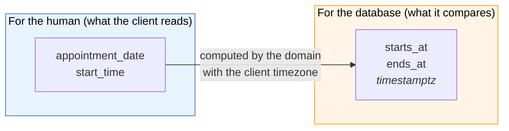
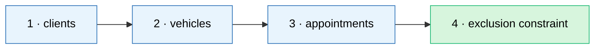
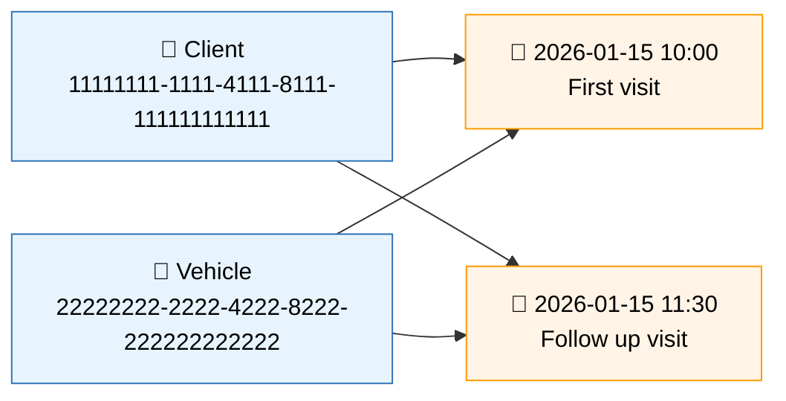
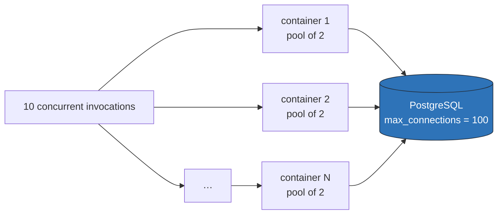

# Database

PostgreSQL is the source of truth. The schema is created by **versioned
migrations** written in TypeScript, so it is applied identically in local
development, in the acceptance tests and in AWS.

## Entity model

The statement defines three entities: the appointments, the client and the
vehicle.

```mermaid
erDiagram
    CLIENTS ||--o{ APPOINTMENTS : "books"
    VEHICLES ||--o{ APPOINTMENTS : "is booked for"
    CLIENTS {
        uuid id PK
        text name
        text timezone
        text address
        timestamptz created_at
        timestamptz updated_at
    }
    VEHICLES {
        uuid id PK
        text vin UK
        text plates
        text color
        int year
        text model
        timestamptz created_at
        timestamptz updated_at
    }
    APPOINTMENTS {
        uuid id PK
        uuid client_id FK
        uuid vehicle_id FK
        date appointment_date
        time start_time
        timestamptz starts_at
        timestamptz ends_at
        text comments
        appointment_status status
        timestamptz created_at
        timestamptz updated_at
    }
    MIGRATIONS {
        bigint timestamp PK
        text name
    }
```



### Why `starts_at` and `ends_at` next to `date` and `time`



The statement asks for a *date* and a *time* per appointment, and the client
is identified by a **timezone**. A local date and time is not a point in
time, so the application converts it into an absolute range (`starts_at`,
`ends_at`) using the timezone of the client and the configured slot duration.
The database compares the absolute ranges (that is what makes the exclusion
constraint possible), and the API answers with the local values.

The `appointment_status` is a PostgreSQL **enum** (`HABILITADA` /
`DESHABILITADA`), which makes an invalid status impossible at the database
level.

## Migrations

| # | Migration | Content |
| --- | --- | --- |
| 1 | `CreateClientsTable` | `clients` with id, name, timezone, address and audit columns |
| 2 | `CreateVehiclesTable` | `vehicles` with id, VIN (unique), plates, color, year, model and audit columns |
| 3 | `CreateAppointmentsTable` | `appointments` with the foreign keys, the date, the time, the absolute range, the comments, the status enum and the audit columns |
| 4 | `AddAppointmentSlotOverlapConstraint` | The partial exclusion constraint that prevents double bookings |



The migrations are applied by `pnpm db:migrate` locally and by the `migrate`
Lambda in AWS. They are **idempotent**: only the pending ones are applied, so
running them twice is harmless.

```bash
pnpm db:migrate        # apply the pending migrations
pnpm db:revert         # undo the last one
pnpm db:seed           # load the demonstration data
```

## The double booking constraint

```sql
EXCLUDE USING gist (
  tstzrange(starts_at, ends_at, '[)') WITH &&
) WHERE (status = 'HABILITADA')
```

| Part | Effect |
| --- | --- |
| `tstzrange(starts_at, ends_at, '[)')` | The slot, as a half open interval: 10:00–11:00 and 11:00–12:00 do not overlap. |
| `WITH &&` | Conflicting rows are rejected. |
| `WHERE status = 'HABILITADA'` | Only the enabled appointments are considered, so a cancelled appointment frees its slot at once. |

The violation is reported as `SQLSTATE 23P01` and translated into a
`SlotNotAvailableError`, which the API renders as `409 SLOT_NOT_AVAILABLE`.
See [ADR 0006](../decisions/0006-postgresql-and-exclusion-constraint.md).

## Indexes

| Index | Table | Why |
| --- | --- | --- |
| `idx_appointments_date` | `appointments (appointment_date)` | The listing by date is the most frequent query |
| `idx_appointments_client_id` | `appointments (client_id)` | "Appointments of a client" |
| `idx_appointments_vehicle_id` | `appointments (vehicle_id)` | "Appointments of a vehicle" |
| `idx_appointments_status` | `appointments (status)` | The partial constraint filters by status |
| `uq_vehicles_vin` | `vehicles (vin)` | The VIN identifies a vehicle |

The overlap lookup uses the GiST index created by the exclusion constraint, so
the pre-check of a slot is an index scan instead of a sequential one.

## The demonstration data

The seed loads a repair shop with one client, one vehicle and two appointments
(the same data the acceptance tests use), so the deployed API answers with
something meaningful:



## Connections and pools

Each warm container keeps its own connection pool:

| Setting | Value | Reason |
| --- | --- | --- |
| `DB_POOL_SIZE` | 2 in AWS, 10 by default | The concurrency of the function is reserved to 10, so 10 containers × 2 connections = 20 connections, well below the default `max_connections` of PostgreSQL. |
| `reservedConcurrency` | 10 | Prevents a burst from opening an unbounded number of pools. |



## Related documents

- [ADR 0006](../decisions/0006-postgresql-and-exclusion-constraint.md) — why
  the double booking is enforced by the database.
- [ADR 0010](../decisions/0010-database-hosting.md) — Coolify now, RDS later.
- [../operations/runbook.md](../operations/runbook.md) — how to apply the
  migrations in each environment.
