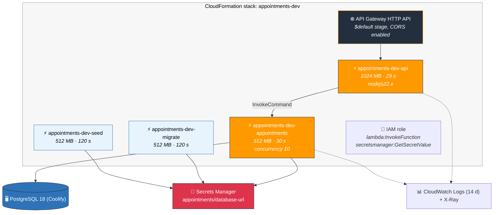
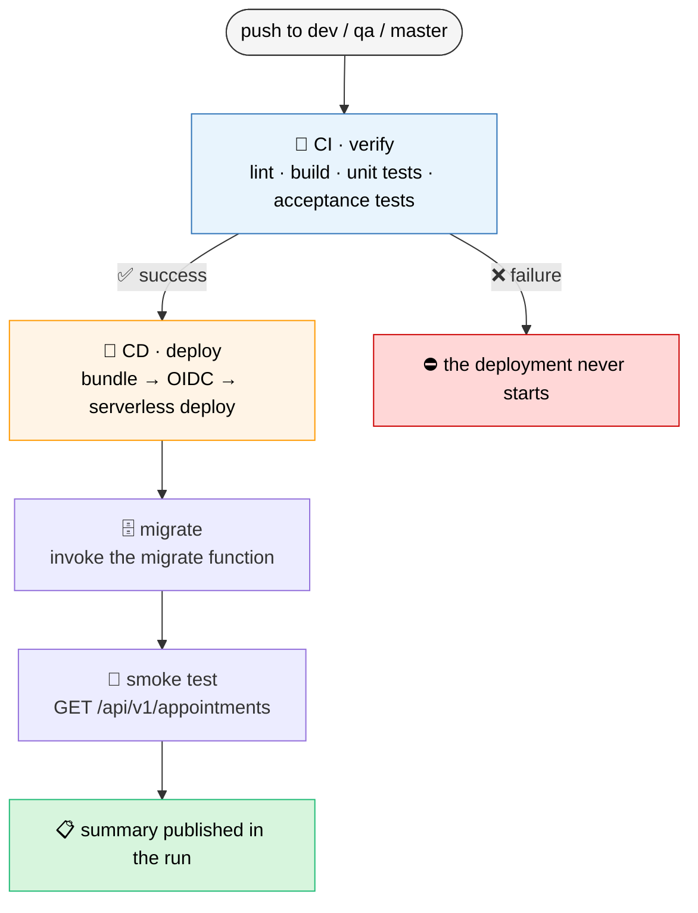
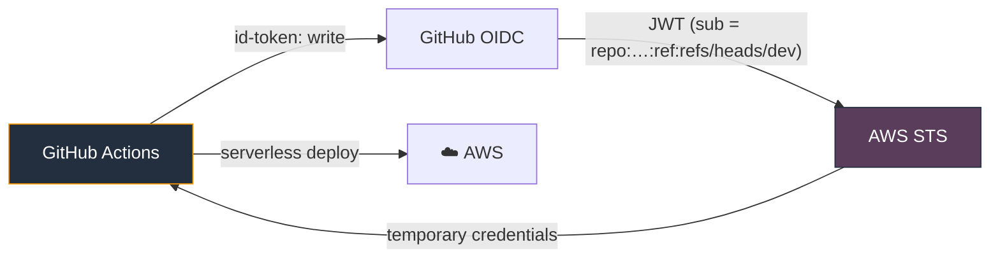
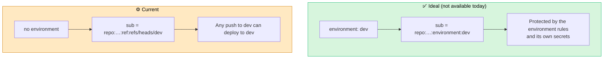
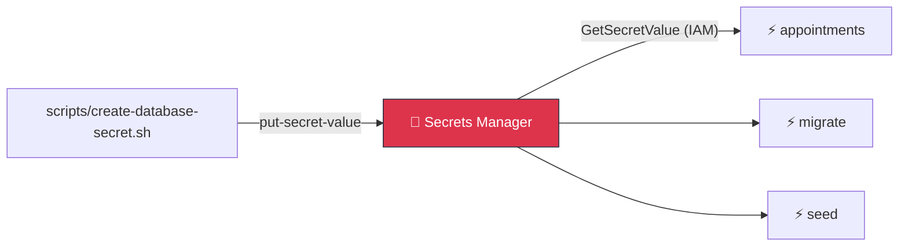
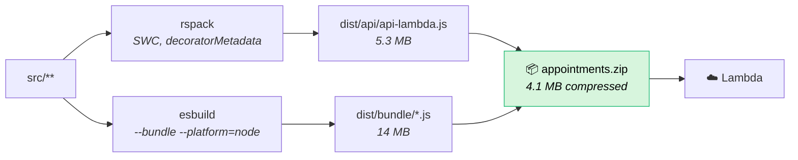
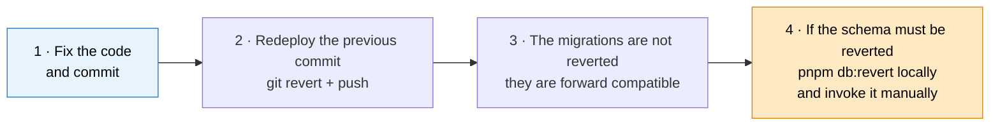

# Deployment

The whole system is deployed with **Serverless Framework** into a single
CloudFormation stack per stage.

## The deployed environment

| Property | Value |
| --- | --- |
| Account | `550711951109` |
| Region | `us-east-1` |
| Stage | `dev` |
| Stack | `appointments-dev` |
| Public endpoint | <https://5sg14jfok6.execute-api.us-east-1.amazonaws.com> |
| Interactive documentation | <https://5sg14jfok6.execute-api.us-east-1.amazonaws.com/api/docs> |
| OpenAPI document | <https://5sg14jfok6.execute-api.us-east-1.amazonaws.com/api/openapi.json> |



## The functions

| Function | Handler | Memory | Timeout | Trigger |
| --- | --- | --- | --- | --- |
| `api` | `dist/api/api-lambda.apiLambdaHandler` | 1024 MB | 29 s | API Gateway (`*`) |
| `appointments` | `dist/bundle/handler.appointmentsLambdaHandler` | 512 MB | 30 s | `lambda:Invoke` from `api` |
| `migrate` | `dist/bundle/handlers/migrate-handler.migrateHandler` | 512 MB | 120 s | The pipeline |
| `seed` | `dist/bundle/handlers/seed-handler.seedHandler` | 512 MB | 120 s | Manual |

The API timeout is 29 seconds because API Gateway caps the request at 30: the
function has to answer before the gateway gives up.

## The CI/CD pipeline



| Workflow | File | Trigger | Job |
| --- | --- | --- | --- |
| CI | `.github/workflows/ci.yml` | Push and pull request | `verify` (also reusable) |
| CD | `.github/workflows/cd.yml` | Push to `dev`, `qa`, `master` and manual | `verify` → `deploy` |

The CD **reuses** the CI workflow as a gate (`needs: verify`), so code that
does not pass the tests is never deployed.

### Stages

| Branch | Stage | Stack |
| --- | --- | --- |
| `dev` | `dev` | `appointments-dev` |
| `qa` | `qa` | `appointments-qa` |
| `master` | `prod` | `appointments-prod` |

## Authentication: OIDC without static keys



The repository only stores the **ARN of the role**
(`arn:aws:iam::550711951109:role/appointments-deploy`), which is an
identifier, not a credential. See
[ADR 0009](../decisions/0009-oidc-and-secrets-manager.md).

### Limitation: no GitHub environments

The repository does not allow creating **GitHub environments**, so the
workflow cannot use the strictest mode (an environment can require reviewers
and hold its own secrets). The workflow therefore assumes the role with the
**branch** subject (`ref:refs/heads/<branch>`) instead of the environment one.



The trust policy of the role **accepts both subjects**, so enabling the
environments later is a one line change in `cd.yml` and no change in AWS:

```yaml
jobs:
  deploy:
    environment: ${{ env.STAGE }}
```

## The secret of the database

| Property | Value |
| --- | --- |
| Name | `appointments/database-url` |
| Payload | `{"DATABASE_URL": "postgres://…"}` |
| Created by | `scripts/create-database-secret.sh` (asks for the password without echoing it) |
| Read by | The `appointments`, `migrate` and `seed` functions |



The `api` function has **no** permission over the secret: it never talks to
the database.

## Packaging



Only the built artifacts travel: `package.patterns` excludes everything else
from the zip. The first attempt, which shipped the `node_modules` of pnpm,
produced a 589 MB package that AWS would have rejected.

## Deploying by hand

```bash
export PATH="$HOME/.local/aws-cli/v2/current/bin:$PATH"

pnpm bundle:lambda && pnpm build:api-lambda
npx serverless deploy --stage dev --region us-east-1
npx serverless invoke --function migrate --stage dev --data '{}'
npx serverless invoke --function seed    --stage dev --data '{}'
```

## Rolling back



## Related documents

- [../operations/runbook.md](../operations/runbook.md) — the operational
  procedures.
- [../operations/costs.md](../operations/costs.md) — what this costs.
- [ADR 0004](../decisions/0004-infrastructure-as-code.md) — why Serverless
  Framework.
- [ADR 0008](../decisions/0008-bundling-strategies.md) — why two bundlers.
