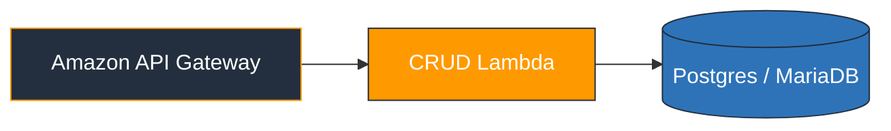
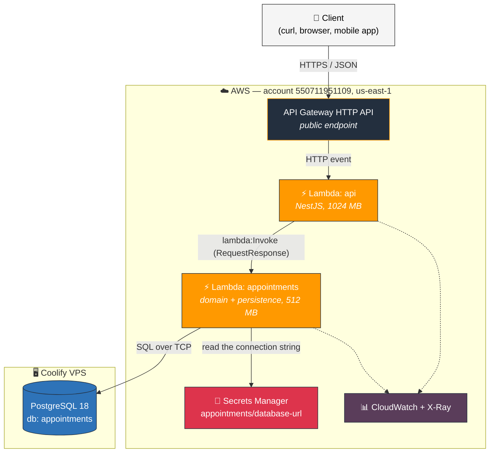
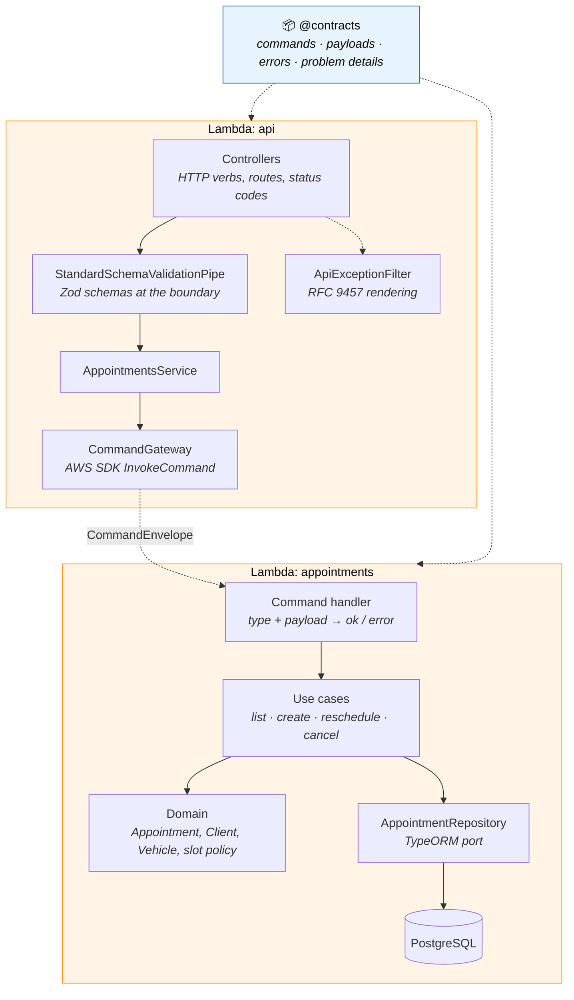
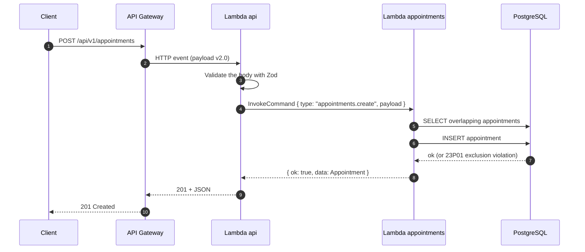
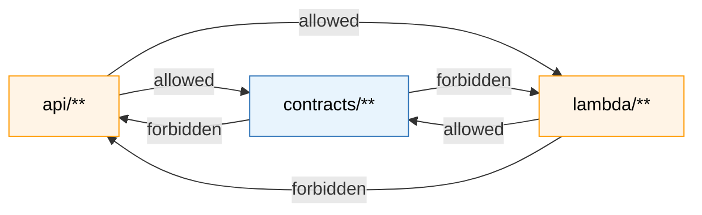

# Architecture overview

The system is a REST API for a vehicle repair shop. It runs entirely on AWS
Serverless and stores its data in PostgreSQL.

The technical statement asked for *"a small REST API in local, that allows
consuming a Lambda to perform a CRUD against a local database"* and drew the
following reference architecture:



That is exactly the shape of the solution: the API **consumes** a Lambda that
performs the CRUD. The implementation keeps that shape and makes the contract
between both explicit.

## System context



## Containers

| Container | Technology | Responsibility |
| --- | --- | --- |
| **Public API** | NestJS 12, Node.js 22, Lambda | Terminates HTTP, validates the request contract, renders RFC 9457 errors, publishes the OpenAPI document. It never touches the database. |
| **Appointments service** | TypeScript, TypeORM, Lambda | Owns the domain rules, the use cases and the persistence. It never knows about HTTP. |
| **Database** | PostgreSQL 18 | Stores the appointments, the clients and the vehicles. Enforces the double booking rule. |
| **Secret store** | AWS Secrets Manager | Holds the PostgreSQL connection string. |

## Components inside the Lambda functions



## The contract between both functions

The API never imports the business logic, and the service never imports
anything HTTP related. They only share the `contracts` package, which defines
the messages both sides speak:



The messages are defined in `src/contracts`:

| Contract | Purpose |
| --- | --- |
| `command-contracts.ts` | `CommandEnvelope` (request) and `CommandResult` (response) |
| `appointments/commands.schemas.ts` | Payload of every command, validated with Zod |
| `appointments/errors.ts` | The error codes both sides understand |
| `protocol/problem.schemas.ts` | The RFC 9457 document rendered by the API |

## Layer rules (hexagonal architecture)

The dependency rule is **enforced by the linter**, not only by convention
(`pnpm lint` runs `src/tools/check-boundaries.ts`):



| From | May import |
| --- | --- |
| `src/api` | `src/contracts`, `src/lambda` |
| `src/lambda` | `src/contracts` |
| `src/contracts` | nothing (it is pure data and schemas) |

The API is allowed to import the lambda layer because it needs the domain
types to build its responses; the lambda layer must never import the API
layer, because that would couple the business rules to HTTP.

## Project layout

```text
src/
├── api/                  # HTTP layer
│   ├── application/      #   use cases and ports used by the API
│   ├── config/           #   environment configuration
│   ├── errors/           #   RFC 9457 problem details
│   ├── http/             #   OpenAPI helpers
│   ├── inbound/http/     #   controllers, pipes and filters
│   └── outbound/lambda/  #   the AWS SDK gateway
├── contracts/            # shared contracts (no dependencies)
├── lambda/               # business layer
│   ├── config/           #   secret provider
│   ├── handlers/         #   migrate and seed handlers
│   └── modules/appointments/
│       ├── application/  #     use cases, mappers, ports
│       ├── domain/       #     entities, value objects, policies
│       └── infrastructure/persistence/  # TypeORM, migrations, seed
├── tools/                # local tooling (migrate, seed, local runtime)
├── app.module.ts         # composition root of the API
└── api-lambda.ts         # entry point of the API Lambda
```

## Related documents

- [data-flow.md](data-flow.md) — the flow of every operation, step by step.
- [database.md](database.md) — the data model and its constraints.
- [deployment.md](deployment.md) — the AWS topology and the CI/CD pipeline.
- [../decisions/](../decisions/) — why each technology was chosen.
