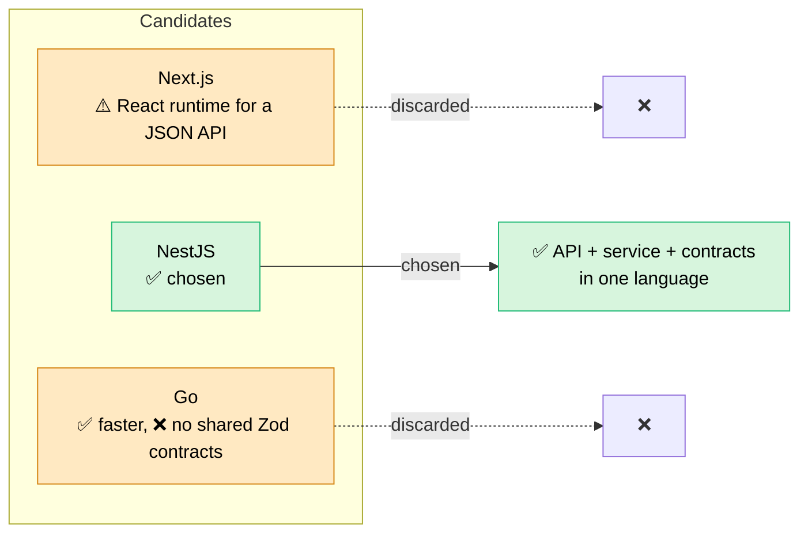

# ADR 0001 — NestJS as the API framework

- **Status:** accepted
- **Date:** 2026-11-19
- **Related:** [0002](0002-validation-with-zod.md), [0005](0005-two-lambda-split.md)

## Context

The technical statement leaves the language and the framework open: it only
constrains the *infrastructure as code* tool (Serverless Framework, AWS SAM or
Local) and the shape of the solution (an API that consumes a Lambda performing
the CRUD).

The API has to be deployed as a **Lambda**, behind **API Gateway**, serving
JSON to other systems. It never renders HTML, never ships a browser bundle and
never runs a client-side router.

Three families of options were on the table:

| Option | What it is | Where it shines |
| --- | --- | --- |
| **Next.js** | React framework with route handlers (`app/api/**/route.ts`) | Full stack web: SSR, SSG, streaming, React Server Components, SEO |
| **NestJS** | Backend framework with DI, modules and decorators | Structured services: controllers, providers, ports and adapters, OpenAPI |
| **Go** | Compiled, statically typed language | Throughput, tiny memory footprint, very fast cold starts |

## Decision

We use **NestJS 12 on TypeScript** for the public API, and plain **TypeScript**
for the appointments service.

### Why not Next.js

Next.js is an excellent framework, but its core value proposition does not
apply to this service:

1. **Its main features are rendering features.** SSR, hydration, image
   optimisation, streaming and the React Server Components runtime exist to
   produce HTML for a browser. This API returns JSON to a machine.
2. **Its request model is the web model.** A route handler receives a `Request`
   and returns a `Response`. The interesting part of this API is the
   *contract* (validation, error rendering, OpenAPI), which in Next.js has to
   be assembled by hand in every route handler.
3. **React would be in the cold start.** Every container would load React and
   the Next.js runtime before answering the first request, for a service that
   never renders a component.
4. **The problem asked for a REST API with a documented contract.** NestJS
   gives decorators, a dependency injection container, a validation pipe and
   first party OpenAPI support (`@nestjs/swagger`) out of the box.

Next.js would have worked, but it would have meant building by hand the
validation, the DI and the error rendering that NestJS provides natively.

### Why not Go

Go was the strongest alternative, and it is still the right answer for a
**compute** sensitive workload:

| Criterion | Go | TypeScript (chosen) |
| --- | --- | --- |
| Cold start | ~150 ms | ~500 ms (measured: 487 ms of init) |
| Memory | ~40 MB | ~118 MB (measured) |
| Cost at 1M requests | Lower | Higher (still inside the free tier) |
| Validation | `go-playground/validator` + generated OpenAPI | Zod, one schema for runtime **and** OpenAPI |
| Shared contract between the two Lambdas | Needs code generation | One TypeScript package, imported by both |
| Type safety across the boundary | Compile time | Compile time **and** runtime (Zod parses the answer) |

The deciding factor was the **shared contract**. Both Lambdas must agree
exactly on the shape of the messages; in TypeScript that contract is a single
package (`src/contracts`) validated at runtime by Zod and reused to generate
the OpenAPI document. In Go the same contract would require code generation or
a duplicated hand written model, and the runtime validation would have to be
written twice.

The cost of the decision is honest and measurable: a Go implementation would
be roughly **3x cheaper per invocation** and start **3x faster**. For a
repair shop booking API with a few thousand requests per month that difference
is irrelevant, and it would be paid back many times over by the productivity
of a single language across the API, the service, the contracts and the tests.

## Consequences

**Positive**

- One language, one toolchain, one `package.json` for the API, the service,
  the contracts and the tests.
- The OpenAPI document is generated from the same schemas that validate the
  runtime traffic, so it cannot drift.
- The hexagonal boundaries are expressed with modules and providers, and
  enforced by the linter.
- The team can reuse the same testing approach (Jest, Cucumber) on both sides.

**Negative**

- Cold starts and memory are worse than a compiled runtime.
- The bundle is bigger (4.1 MB per function instead of a few hundred KB), which
  increases the deployment time slightly.
- `emitDecoratorMetadata` is required by NestJS, so the API cannot be bundled
  with esbuild (see [ADR 0008](0008-bundling-strategies.md)).

**When to revisit**

If the API ever had to serve a high volume of traffic (millions of requests
per month) or if the cold start became visible to the users, porting the
*public API* to Go (or to a minimal handler) while keeping the contracts
package generated from the Zod schemas would be the cheapest way to recover
the difference. The current traffic profile does not justify it.
