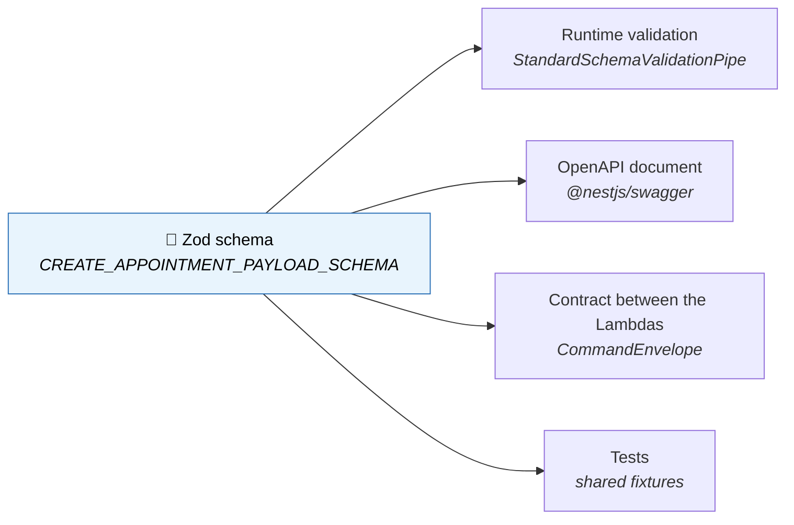
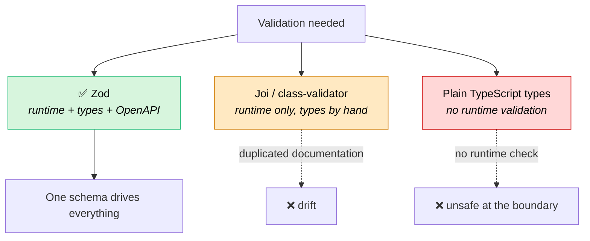

# ADR 0002 — Zod as the single source of truth for validation

- **Status:** accepted
- **Date:** 2026-11-19
- **Related:** [0001](0001-api-framework.md), [0003](0003-errors-rfc-9457.md), [0007](0007-shared-contracts.md)

## Context

The API receives untrusted input, and the two Lambdas exchange messages that
must match exactly. Three things usually need to be described separately:

1. The validation that happens at runtime.
2. The documentation of the API (OpenAPI).
3. The shape of the messages between the functions.

When those are written by hand they drift: a field is added to the database
but not to the OpenAPI document, or the service starts answering with a field
the API does not know how to read.

## Decision

Every payload, query, parameter and message is described **once**, with
**Zod**, and that schema is used for runtime validation, for OpenAPI
generation and for the contract between the two Lambdas.

## Why Zod

- **Runtime validation at every boundary.** A malformed body is rejected
  before it reaches the use case, and the answer of the Lambda is validated
  before it reaches the client.
- **One source of truth for the types.** `z.infer<typeof Schema>` gives the
  TypeScript type, so the compiler and the runtime always agree.
- **Standard Schema.** NestJS 12 can validate any Standard Schema library
  through `StandardSchemaValidationPipe`, without decorators or metadata.
- **Rich error reporting.** The issues produced by Zod are mapped to the
  `errors` array of the problem document (`path` + `message`), which is
  exactly what RFC 9457 asks for.
- **Reusable in the service.** The service validates the payload of the
  command with the same schema the API used, so a malformed message is
  rejected on both sides with the same code.

## Zod versus a compiled language

In Go the equivalent would be `go-playground/validator` (runtime) plus
`swaggo` or `oapi-codegen` (documentation). The validation would work, but the
OpenAPI document would be a **second, hand written description** of the same
structures, and the only way to guarantee they match is code generation in the
build pipeline. Zod removes that extra step: the schema *is* the contract.

## Consequences

**Positive**

- The OpenAPI document cannot drift from the validation: it is generated from
  the same object.
- The field level errors of the problem documents are precise
  (`{"path": "date", "message": "Invalid ISO date"}`).
- The tests reuse the schemas to build valid and invalid fixtures.

**Negative**

- Zod is a runtime dependency, so the bundle grows (it is tree shaked into
  the 4.1 MB package).
- The schemas are objects, not types: they cannot be used in a `type` position
  without `z.infer`.
- NestJS needs `emitDecoratorMetadata` for the OpenAPI decorators, which
  rules out esbuild for the API (see
  [ADR 0008](0008-bundling-strategies.md)).

## Where the schemas live

| Schema | File | Used by |
| --- | --- | --- |
| Command payloads | `src/contracts/appointments/commands.schemas.ts` | API (validation) and service (validation) |
| Appointment entity | `src/contracts/appointments/appointment.schemas.ts` | API (response) and service (mapper) |
| Problem document | `src/contracts/protocol/problem.schemas.ts` | API (rendering) |
| Command envelope | `src/contracts/protocol/command-contracts.ts` | API (gateway) and service (handler) |
