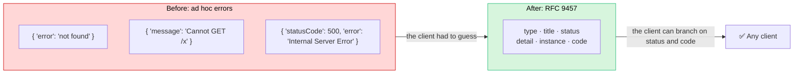
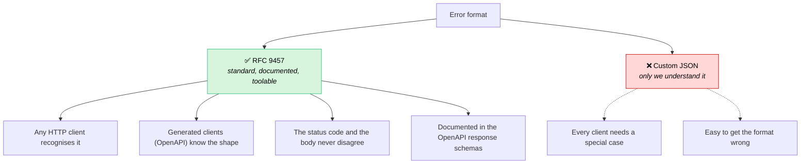
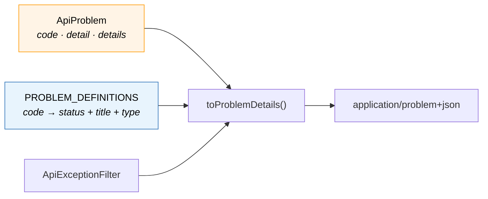

# ADR 0003 — RFC 9110 and RFC 9457 for the error responses

- **Status:** accepted
- **Date:** 2026-11-19
- **Related:** [0002](0002-validation-with-zod.md), [0007](0007-shared-contracts.md)

## Context

An API consumed by other systems needs to answer errors in a way the client
can understand **without hardcoding the message**. The classic problem of
`{"error": "Something went wrong"}` is that the client can only parse a
string, cannot distinguish cases and cannot show something useful to a human.

## Decision

The API answers every error with a **problem details** document:

- **RFC 9110** defines the HTTP semantics (status codes, methods, headers).
- **RFC 9457** defines the body: `application/problem+json`.



## The document

```json
{
  "type": "https://api.alten.com/problems/slot-not-available",
  "title": "The time slot is already taken",
  "status": 409,
  "detail": "The requested time slot is already taken.",
  "instance": "/api/v1/appointments",
  "code": "SLOT_NOT_AVAILABLE",
  "errors": [{ "path": "date", "message": "Invalid ISO date" }],
  "context": { "date": "2026-03-10", "time": "09:00" }
}
```

| Member | Source | Purpose |
| --- | --- | --- |
| `type` | RFC 9457 | URI that identifies the *kind* of problem. It is an identifier, it does not have to resolve. |
| `title` | RFC 9457 | Short, human readable summary. Constant for a given `type`. |
| `status` | RFC 9457 | The HTTP status code, repeated in the body for convenience. |
| `detail` | RFC 9457 | Explanation of *this* occurrence. |
| `instance` | RFC 9457 | The URI of the request that failed. |
| `code` | extension | Stable, machine readable code (`SLOT_NOT_AVAILABLE`). |
| `errors` | extension | Field level errors, only for validation failures. |
| `context` | extension | Domain data that helps the client (the conflicting slot). |

## Why the RFC instead of a custom format



1. **It is a standard, not an invention.** The format is defined by the IETF
   and is already implemented by API clients, API gateways and documentation
   generators.
2. **The status code and the body always agree.** RFC 9457 makes the status
   part of the document, so a client can trust both.
3. **It plays well with OpenAPI.** The responses are declared with the
   `application/problem+json` content type, so the generated documentation
   shows the error bodies, not just the status codes.
4. **It separates the stable part from the volatile part.** `type` and `title`
   change only when the semantics change; `detail` can change freely. That is
   what allows clients to branch on `code` without parsing prose.
5. **Field level errors have a natural place.** The `errors` array with
   `path` and `message` is the convention the RFC establishes, so the Zod
   issues can be mapped to it directly.

## How it is implemented



- `src/api/errors/problem-details.ts` holds the catalogue
  (`PROBLEM_DEFINITIONS`): one entry per error code with its status, title
  and type URI.
- `src/api/inbound/http/api-exception.filter.ts` catches everything (domain
  errors, HTTP exceptions and unexpected failures) and renders the document.
- `src/contracts/protocol/problem.schemas.ts` validates the document with Zod
  before it leaves the process, and is reused to declare the OpenAPI
  responses.

The catalogue is the only place where the status codes are decided, so the
API, the documentation and the tests cannot disagree.

## Consequences

**Positive**

- The clients have a documented, stable contract for the failures.
- The error catalogue is a single file: adding a code is a one line change
  plus its documentation.
- Internal failures never leak details: the upstream error is logged and the
  client receives a generic message.

**Negative**

- The `type` URIs point to `https://api.alten.com/problems/...`, a domain
  that does not exist yet. That is legal (the member is an identifier), but
  the URLs could be served later to document each error.
- The extensions (`code`, `errors`, `context`) are not part of the RFC: a
  strict client must ignore the unknown members, which every RFC 9457 client
  is required to do.
