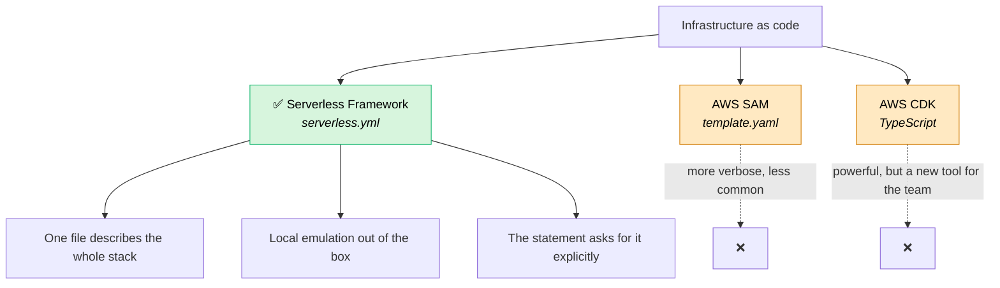
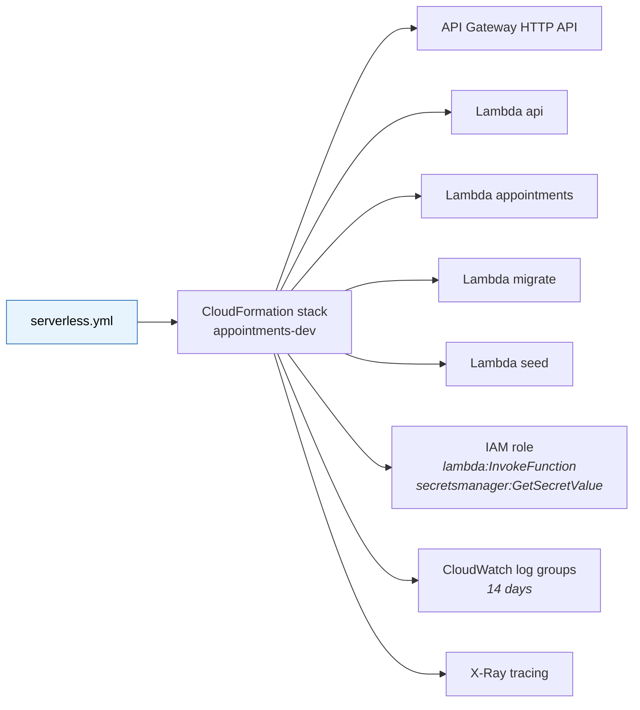

# ADR 0004 — Serverless Framework as the infrastructure as code tool

- **Status:** accepted
- **Date:** 2026-11-19
- **Related:** [0005](0005-two-lambda-split.md), [0009](0009-oidc-and-secrets-manager.md)

## Context

The technical statement asks for the API to be built with one of:

- **Serverless Framework** (preferred)
- **AWS SAM**
- **Local**

The deployment has to produce API Gateway, Lambda functions, IAM roles, log
groups, the database secret and the X-Ray tracing, in a reproducible way.

## Decision

We use **Serverless Framework** with a single `serverless.yml` that declares
the whole stack.

### Why Serverless Framework

1. **The statement lists it as the preferred option.** Following the
   preference removes any discussion about the tool.
2. **One declarative file.** `serverless.yml` describes the functions, their
   handlers, memory, timeout, concurrency, IAM statements, environment
   variables and the HTTP API events. It is 100 lines and readable.
3. **It generates CloudFormation.** The stack is reproducible, versioned and
   can be inspected in the AWS console: `serverless.yml` is the source of
   truth, CloudFormation is the execution.
4. **It packages the artifacts.** `package.patterns` decides what goes into
   the deployment zip, which is what allowed us to ship a 4.1 MB bundle
   instead of the 589 MB that the `node_modules` of pnpm would have produced.
5. **The local emulation is not needed.** The project already has a local
   runtime that emulates the Lambda Invoke API with the real AWS SDK
   (`pnpm local:lambda`), which is closer to production than the Serverless
   emulator.

### Why not SAM

SAM is perfectly valid and integrates natively with CodeBuild and the AWS
console, but the template is more verbose: every function needs its own
`AWS::Serverless::Function` resource with the same metadata that the
Serverless Framework infers (packaging, layers, IAM roles). For four
functions the difference is visible, and the Serverless Framework is the
option the statement prefers.

### Why not CDK

The CDK is powerful and would let us write the infrastructure in TypeScript,
but it adds a compilation step and a second mental model (constructs and
synthesised CloudFormation). The stack here is small enough that a
declarative YAML is easier to review.

## What the stack declares

## Consequences

**Positive**

- The whole infrastructure is versioned in the same repository as the code.
- The same command deploys to `dev`, `qa` and `prod`:
  `serverless deploy --stage <stage>`.
- The pipeline does not need a second tool: `npx serverless deploy` is the
  only step.

**Negative**

- Serverless Framework v3 warns about the `nodejs22.x` runtime, because its
  schema does not know it yet. The warning is harmless: the value is passed
  to CloudFormation and the functions really run on Node.js 22.
- The framework requires a Node.js runtime on the machine that deploys, which
  the CI runner already provides.
