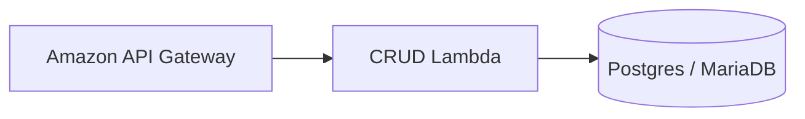
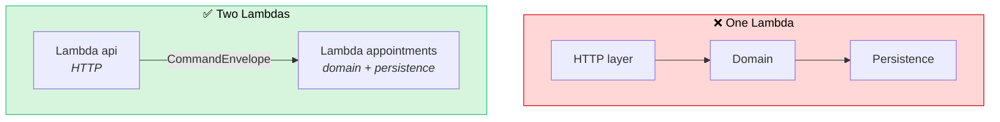
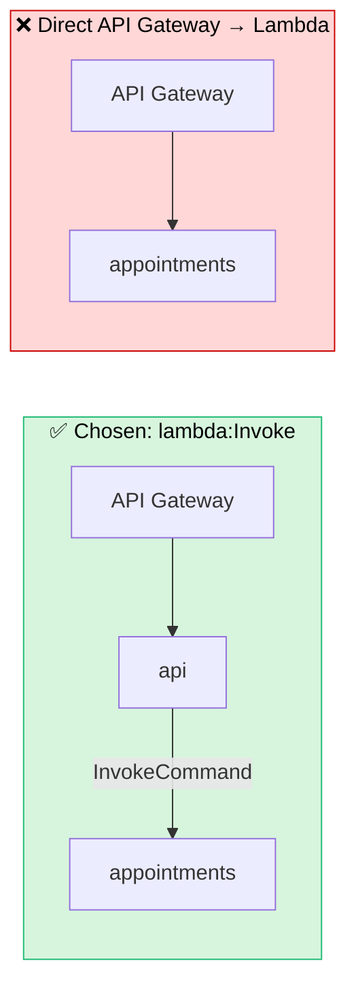

# ADR 0005 — Two Lambdas: the public API and the appointments service

- **Status:** accepted
- **Date:** 2026-11-19
- **Related:** [0001](0001-api-framework.md), [0004](0004-infrastructure-as-code.md), [0007](0007-shared-contracts.md)

## Context

The technical statement asks for *"a small REST API in local, that allows
consuming a Lambda to perform a CRUD against a local database"*. The reference
diagram is:

The API and the CRUD are therefore two different deployable units. The question
is where the boundary between them is drawn.

## Decision

The stack contains **two Lambdas**:

| Function | Package | Responsibility |
| --- | --- | --- |
| `api` | `src/api/**` + `src/api-lambda.ts` | HTTP only: routing, validation, error rendering, OpenAPI |
| `appointments` | `src/lambda/**` + `src/lambda/handler.ts` | Domain rules, use cases, persistence |

Plus two utility functions that are never invoked by the API:

| Function | Purpose |
| --- | --- |
| `migrate` | Applies the pending migrations. Invoked by the deployment pipeline. |
| `seed` | Loads the demonstration data. Invoked manually. |

## Why split them

1. **It is what the statement asks for.** The API must *consume* a Lambda
   that performs the CRUD; a single Lambda would collapse that boundary.
2. **The public surface stays small.** Only the `api` function is attached to
   API Gateway. The business logic cannot be reached from the internet except
   through the API, and its IAM role is not exposed.
3. **Different scaling profiles.** The API is IO bound and mostly waits for
   the service: 1024 MB and 29 seconds. The service does the database work:
   512 MB and a reserved concurrency of 10, which protects the database
   connection pool.
4. **Different deployment risks.** A change in the domain does not force a
   redeployment of the public surface, and the HTTP layer can evolve (new
   version of the contract, new authentication) without touching the rules.
5. **The boundary is enforced.** The linter forbids the service from
   importing anything HTTP related, so the split cannot rot silently.

## Why the Invoke API and not API Gateway → Lambda → Lambda

- The service is **not** exposed through API Gateway: it is an internal
  dependency, not a public API.
- The `InvokeCommand` is a synchronous request/response call, exactly like an
  HTTP call, which keeps the code simple and the latency predictable.
- The AWS SDK is used **in production and in local development** (pointing at
  the local runtime with `LAMBDA_ENDPOINT`), so there is only one code path.

The cost is one extra network hop and one extra cold start on the first
request of a burst. Measured on the deployed stack: the API answers in ~300 ms
when the service container is warm, and the whole chain takes ~1.1 s from a
cold start.

## Consequences

**Positive**

- The architecture matches the reference diagram of the statement.
- The database credentials only reach the function that needs them.
- The service can be invoked from other places later (events, queues, a
  second API) without changing anything.

**Negative**

- Two cold starts instead of one on the first request.
- The `CommandEnvelope` / `CommandResult` contract has to be maintained (it is
  covered by tests and by Zod schemas on both sides).
- The invocation adds ~40 ms of latency and a small cost per request
  (0.20 USD per million invocations, inside the free tier).
