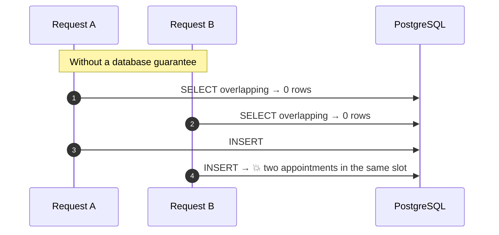
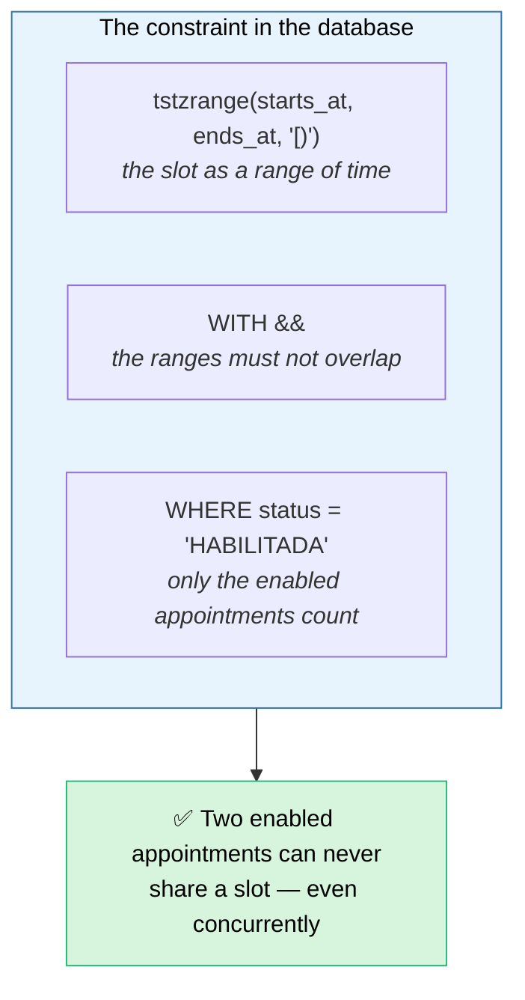
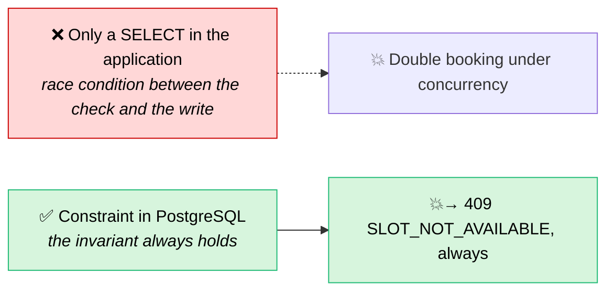
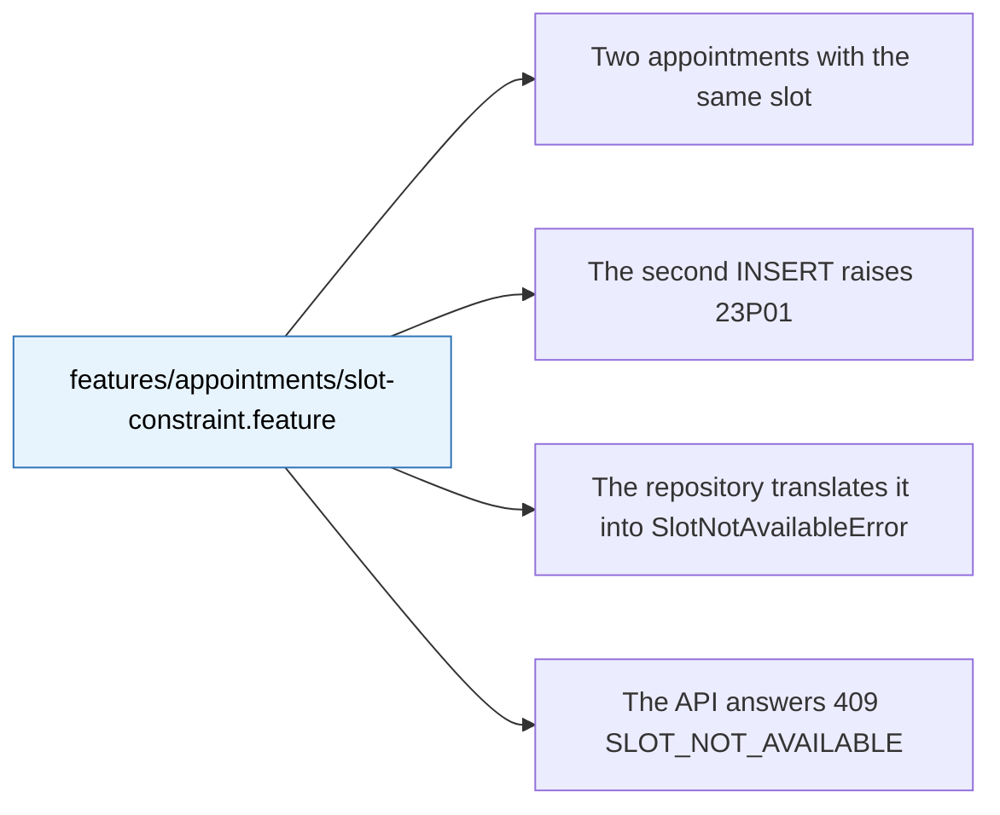

# ADR 0006 — PostgreSQL and an exclusion constraint for the double booking

- **Status:** accepted
- **Date:** 2026-11-19
- **Related:** [0005](0005-two-lambda-split.md), [0010](0010-database-hosting.md)

## Context

The statement requires that creating or rescheduling an appointment
**validates that the slot is not taken by another appointment**.

The naive implementation checks with a `SELECT` and then inserts. That check
has a race window: two concurrent requests can both read "the slot is free"
and then both write.



## Decision

Use **PostgreSQL** and let the database enforce the rule with a **partial
exclusion constraint**:

```sql
ALTER TABLE "appointments"
  ADD CONSTRAINT "ex_appointments_slot_overlap"
  EXCLUDE USING gist (
    tstzrange("starts_at", "ends_at", '[)') WITH &&
  )
  WHERE ("status" = 'HABILITADA');
```

## How it works



| Part | Meaning |
| --- | --- |
| `tstzrange(starts_at, ends_at, '[)')` | The appointment slot. `[)` means *start inclusive, end exclusive*, so 10:00–11:00 and 11:00–12:00 **do not** overlap. |
| `WITH &&` | Two rows conflict when their ranges overlap. |
| `WHERE status = 'HABILITADA'` | The constraint is **partial**: cancelled appointments are ignored, so cancelling frees the slot immediately. |

## Why the database and not the application



1. **The invariant is guaranteed, not attempted.** Every write path (insert,
   update, migration, manual SQL) is protected, even if someone bypasses the
   application.
2. **The violation is a normal outcome, not a crash.** PostgreSQL returns
   `SQLSTATE 23P01`, the repository translates it into a
   `SlotNotAvailableError`, and the API answers `409`. Without the
   translation it would have been a `500` leaking the internal message.
3. **The check in the application is kept** as an optimisation: it returns a
   friendly error without paying for a failed transaction.

## The concurrency test

The pre-check window is around 1.5 ms, while the jitter between two parallel
requests is around 3 ms, so a *timing based* test almost never reaches the
constraint. The acceptance suite therefore tests the guarantee **at the
repository level**, deterministically:



The test has been verified to have teeth: neutralising the translation makes
it fail with `Expected DomainError, Received QueryFailedError`.

## Consequences

**Positive**

- Double bookings are impossible, not merely unlikely.
- Cancelling releases the slot immediately, with no extra job.
- The constraint is documented in the schema, next to the data.

**Negative**

- `btree_gist` has to be enabled in the database to mix `uuid` and `range`
  operators in the same constraint.
- The overlap check has to be expressed in **timestamps with time zone**
  (`starts_at`, `ends_at`), not only with the local date and time, otherwise
  the range comparison is not possible. The application keeps `appointment_date`
  and `start_time` for the same reason: the client reads them, the database
  compares them.
- The slot duration is a business rule (`SLOT_DURATION_MINUTES`, 60 by
  default) that the database does not know about: it only compares the
  ranges it is given.
