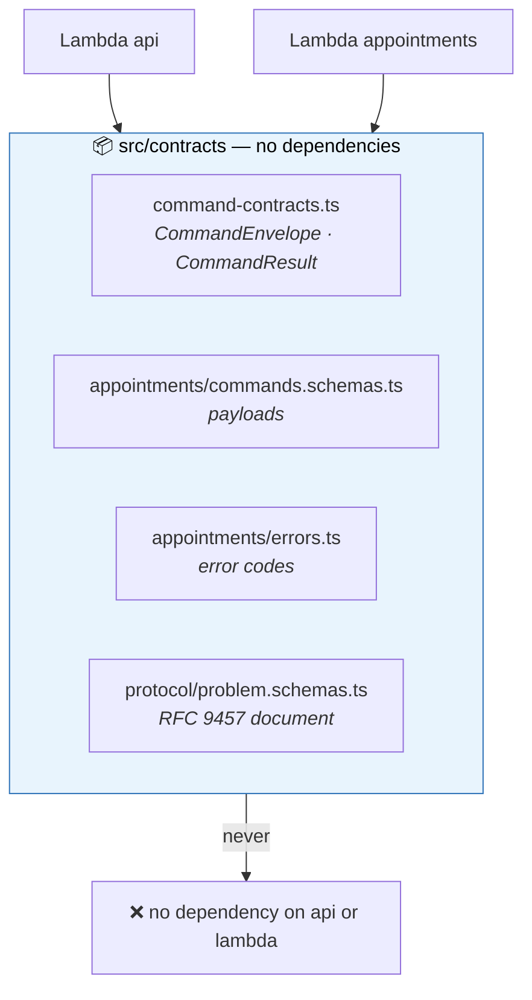
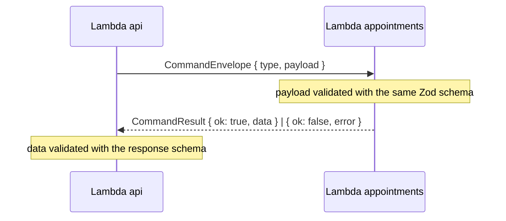
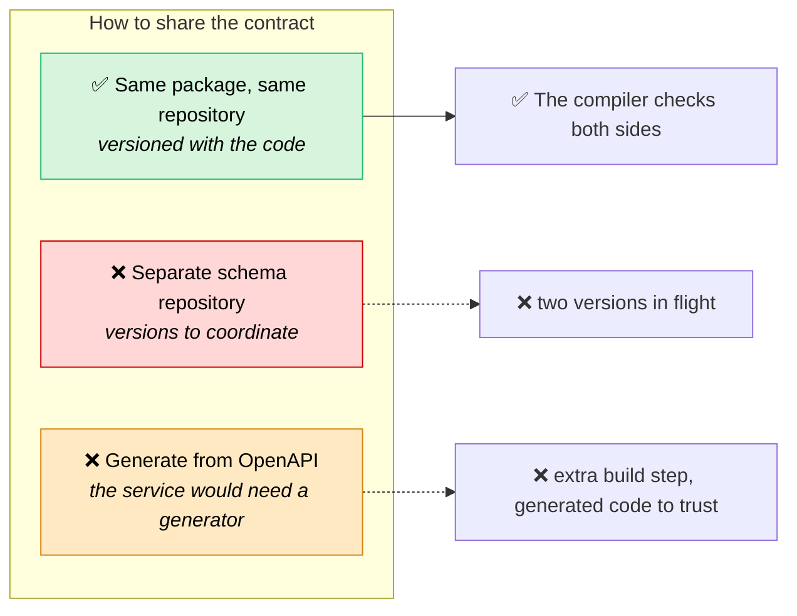
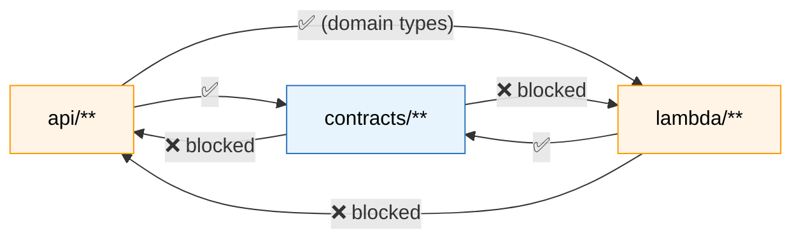

# ADR 0007 — One contracts package shared by both Lambdas

- **Status:** accepted
- **Date:** 2026-11-19
- **Related:** [0002](0002-validation-with-zod.md), [0005](0005-two-lambda-split.md)

## Context

The two Lambdas are deployed independently but they must agree, byte by byte,
on the messages they exchange. A mismatch (a renamed field, an optional field
that becomes mandatory, a new error code) has to be detected, ideally before
it reaches production.

## Decision

Both Lambdas import a **single package with no dependencies**:
`src/contracts`.



## The messages



```ts
// Request
{ "type": "appointments.create", "payload": { "clientId": "…", "vehicleId": "…", "date": "2026-03-10", "time": "09:00" } }

// Success
{ "ok": true, "data": { "id": "…", "status": "HABILITADA", … } }

// Failure
{ "ok": false, "error": { "code": "SLOT_NOT_AVAILABLE", "message": "…", "details": { … } } }
```

## Why a shared package instead of a shared schema repository



- **The compiler verifies both sides.** If the service changes a payload, the
  API stops compiling in the same commit.
- **No extra infrastructure.** No schema registry, no code generation step, no
  second repository to release.
- **The contract is versioned with the code that implements it.** A deployment
  always deploys a matched pair of functions.
- **It is validated at runtime, not only at compile time.** The service
  re-validates the payload it receives and the API re-validates the answer,
  so a message that comes from an older or newer deployment is rejected
  cleanly instead of causing a `TypeError` deep in the use case.

## The boundary rule

The linter (`src/tools/check-boundaries.ts`) enforces the dependency rule:

| From | Allowed imports |
| --- | --- |
| `src/api` | `src/contracts`, `src/lambda` |
| `src/lambda` | `src/contracts` |
| `src/contracts` | nothing |



The rule is part of `pnpm lint`, so it runs on every commit and on the CI.

## Consequences

**Positive**

- A contract change is a compile error, not a runtime surprise.
- The OpenAPI document is generated from the same schemas the service
  validates.
- The error codes are declared once and reused by both sides.

**Negative**

- The two functions cannot be released independently with an incompatible
  contract. That is a deliberate trade: the API and the service are deployed
  from the same stack, so they always match.
- A shared package is a coupling point. It is kept small, dependency free and
  limited to data and schemas.
