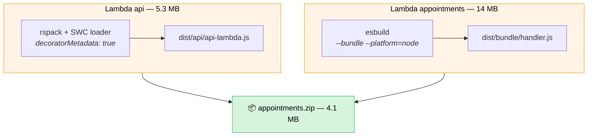
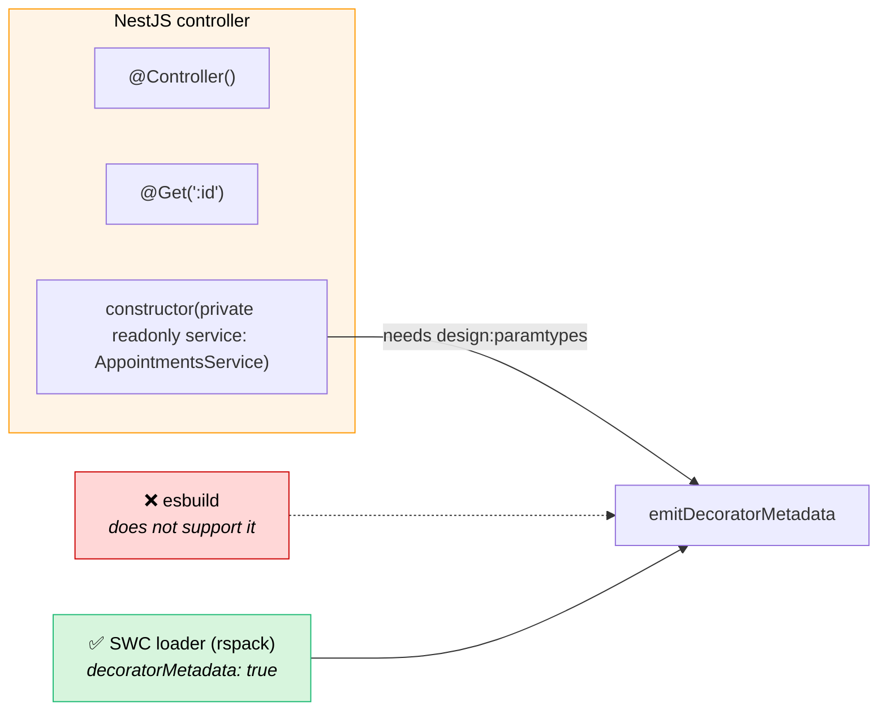

# ADR 0008 — rspack for the API and esbuild for the service

- **Status:** accepted
- **Date:** 2026-11-19
- **Related:** [0001](0001-api-framework.md), [0004](0004-infrastructure-as-code.md)

## Context

A Lambda deployment package has hard limits: **50 MB zipped** and **250 MB
uncompressed**. The first packaging attempt shipped the whole `node_modules`
of pnpm (which uses symlinks) and produced a **589 MB** zip: unusable.

The package has to contain the runtime dependencies, but nothing else.

## Decision

Each function is shipped as **a single JavaScript file**, bundled at build
time, with a different tool for each side.



| Function | Bundler | Why |
| --- | --- | --- |
| `api` | **rspack** (`rspack.lambda.config.js`) | NestJS needs `emitDecoratorMetadata` to resolve the dependencies of the controllers. |
| `appointments` | **esbuild** (`pnpm bundle:lambda`) | Plain TypeScript without decorators: the fastest and simplest bundler. |

### The metadata problem



Without the metadata, Nest cannot tell that the parameter of the constructor
is an `AppointmentsService` and the dependency injection fails at boot with
`Nest can't resolve dependencies of the AppointmentsController`. This is the
reason the two functions do not use the same bundler.

## The packaging rules

```yaml
package:
  patterns:
    - '!./**'          # everything is excluded by default
    - './dist/api/**'  # only the built artifacts travel
    - './dist/bundle/**'
```

## Measured results

| Attempt | Size | Result |
| --- | --- | --- |
| `node_modules` of pnpm | **589 MB** | ❌ rejected by AWS |
| rspack + esbuild, source maps included | **4.1 MB** | ✅ deployed |

## Consequences

**Positive**

- The deployment is small and fast (the stack is deployed in ~40 seconds).
- The package contains only what runs: no devDependencies, no sources, no
  test files.
- The cold start is not penalised by a huge package: the file is read from the
  S3 cache of the Lambda service.

**Negative**

- Two build tools to maintain.
- The source maps of the bundles are not uploaded to CloudWatch yet (the
  `NODE_OPTIONS=--enable-source-maps` flag is already set, so adding the
  `.map` files to the package is a one line change).
- The rspack configuration is custom (`rspack.lambda.config.js`) because the
  default Nest configuration externalises `node_modules`, which would bring
  back the 589 MB problem.
