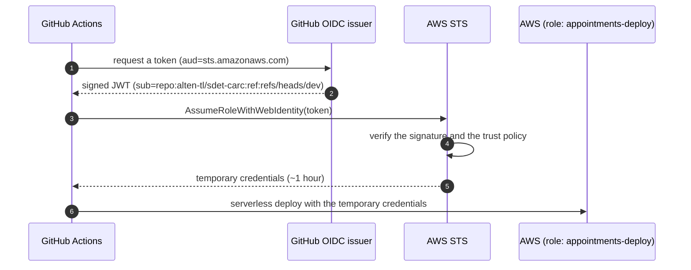
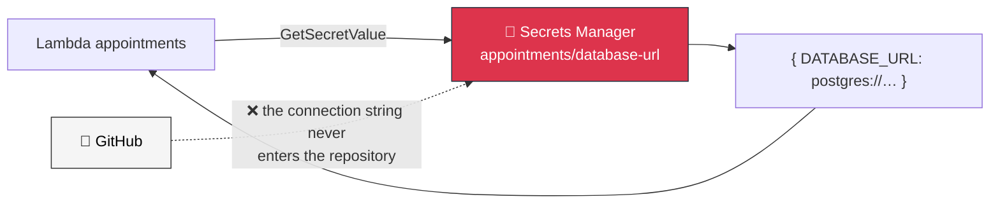
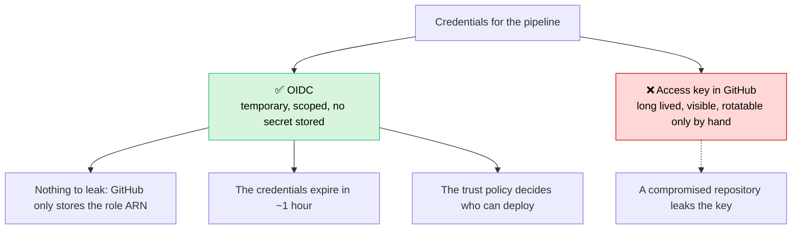

# ADR 0009 — OIDC for the pipeline and Secrets Manager for the credentials

- **Status:** accepted
- **Date:** 2026-11-19
- **Related:** [0004](0004-infrastructure-as-code.md)

## Context

The pipeline needs AWS permissions to deploy the stack. There are three ways
to give them to it:

1. A long-lived access key stored as a secret in GitHub.
2. A short-lived credential obtained by assuming a role.
3. A federated token exchanged directly for credentials (**OpenID Connect**).

The database connection string is a third kind of secret: it is needed at
runtime by the functions, not by the pipeline.

## Decision

### The pipeline: GitHub OIDC, no static keys



The trust policy only accepts the `sub` values of this repository, and the
provider itself is **path scoped** to the repository:

```json
{
  "Effect": "Allow",
  "Principal": { "Federated": "arn:aws:iam::550711951109:oidc-provider/token.actions.githubusercontent.com/alten-tl/sdet-carc" },
  "Action": "sts:AssumeRoleWithWebIdentity",
  "Condition": {
    "StringEquals": { "token.actions.githubusercontent.com:aud": "sts.amazonaws.com" },
    "StringLike": {
      "token.actions.githubusercontent.com/alten-tl/sdet-carc:sub": [
        "repo:alten-tl/sdet-carc:environment:dev",
        "repo:alten-tl/sdet-carc:environment:qa",
        "repo:alten-tl/sdet-carc:environment:prod",
        "repo:alten-tl/sdet-carc:ref:refs/heads/dev",
        "repo:alten-tl/sdet-carc:ref:refs/heads/qa",
        "repo:alten-tl/sdet-carc:ref:refs/heads/master"
      ]
    }
  }
}
```

### The runtime: AWS Secrets Manager



The secret is created by `scripts/create-database-secret.sh`, which asks for
the password **without echoing it**, so it never reaches the shell history.

## Why OIDC and not a stored access key



- **Nothing sensitive is stored in GitHub.** The only value is the ARN of the
  role, which is a public identifier.
- **The permissions are scoped by the trust policy**, not by the secret: the
  role can only be assumed from this repository.
- **The credentials are short lived** and disappear with the job.
- **Auditable**: CloudTrail records every assumption of the role.

## Why Secrets Manager and not an environment variable

- The connection string would otherwise have to be part of the
  CloudFormation template (and therefore of the repository and of the stack
  history).
- Secrets Manager is encrypted, versioned, and its access can be granted per
  function through IAM.
- Rotating the password is a `put-secret-value` call: the next invocation of
  the Lambda picks up the new value without a deployment.

## The limitation of the current setup

The repository does not allow creating **GitHub environments**, so the
workflow cannot use the strictest mode (`environment: dev`, which requires an
approval and can carry protection rules). The workflow therefore runs without
an environment and assumes the role with the branch subject
(`ref:refs/heads/dev`).

The trust policy accepts both forms, so when the environments become
available the workflow only has to add one line:

```yaml
jobs:
  deploy:
    environment: ${{ env.STAGE }}
```

and the deployment will use the `environment:<stage>` subject, which is
strictly narrower.

## Consequences

**Positive**

- The repository contains no credential that can be used to access AWS.
- The role can be rotated (or revoked) without touching the repository.
- The database password never enters the CI logs.

**Negative**

- The first setup needs a one-time bootstrap with an administrator
  (`scripts/bootstrap-aws.sh`).
- The branch based subject is slightly less restrictive than the environment
  based one: any push to `dev` can deploy to the `dev` stage.
