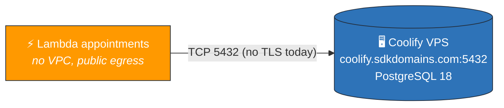
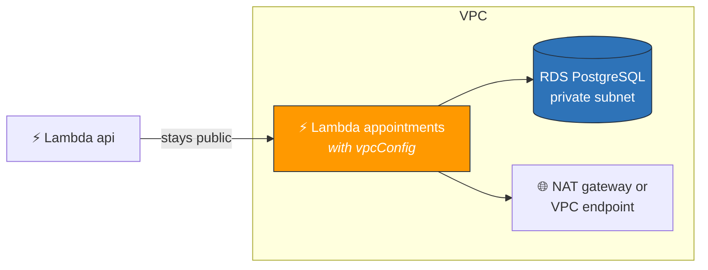
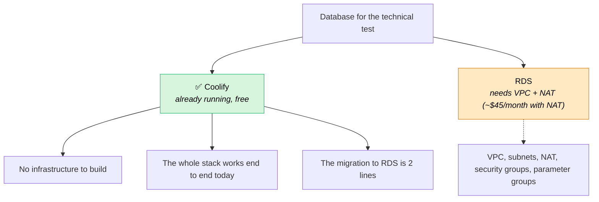
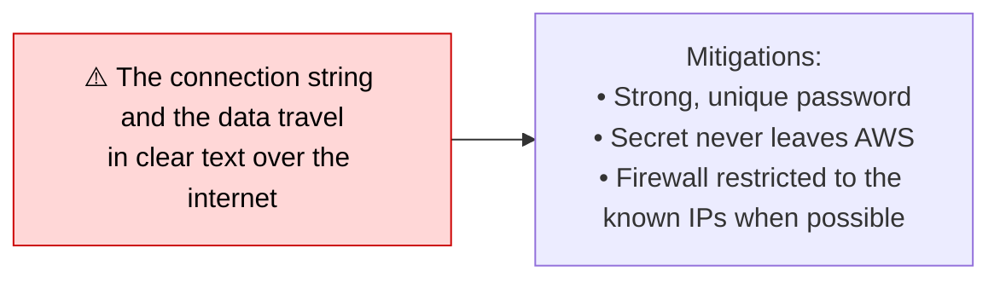

# ADR 0010 — Managed PostgreSQL: Coolify now, RDS later

- **Status:** accepted
- **Date:** 2026-11-19
- **Related:** [0006](0006-postgresql-and-exclusion-constraint.md)

## Context

The database has to be reachable from AWS Lambda. There are three realistic
options:

| Option | Cost | Reachability from Lambda | Operational effort |
| --- | --- | --- | --- |
| **Coolify** (existing VPS) | ~0 USD | Public internet | Low: it already runs |
| **RDS** in a VPC | ~13 USD/month | Private (VPC) | Medium: VPC, subnets, security groups, NAT |
| **RDS** outside a VPC | ~13 USD/month | Public internet | Medium, but not recommended |

## Decision

**Phase 1 (implemented): Coolify PostgreSQL**, reached over the public
internet, with the connection string stored in Secrets Manager.

**Phase 2 (planned): RDS** in a VPC with the function attached to it. The
change is limited to two things:

1. The value of the secret `appointments/database-url` (new host, user,
   password, `?sslmode=require`).
2. The `vpcConfig` of the `appointments`, `migrate` and `seed` functions in
   `serverless.yml`.

## Why Coolify first

- The technical statement asks for a working deployment, not for a managed
  database: the data model, the migrations and the constraints are what is
  being evaluated, and those are identical in both options.
- Coolify was already available, so the effort went into the application and
  the pipeline instead of into the network.
- **The migration path is short.** The application reads the connection
  string from a secret and never mentions the host, so switching to RDS does
  not touch the code.

## The known risk: no TLS

The PostgreSQL instance of Coolify does not currently support SSL, so the
connection travels in clear text:

Three ways to close it, in order of effort:

1. **Enable the TLS proxy of Coolify** (the resource exposes an HTTPS proxy
   in front of PostgreSQL). Smallest change, no code impact.
2. **Enable SSL in the PostgreSQL container** with the certificate of the
   domain and add `?sslmode=require` to the secret.
3. **Move to RDS** with `require` SSL enforced by the parameter group.

The `?sslmode=require` suffix is already supported by the driver (`pg`
parses it from the connection string), so the change is limited to the value
of the secret.

## Consequences

**Positive**

- The API is fully operational against a real PostgreSQL today.
- No additional monthly cost during the evaluation.
- The persistence layer is portable: only the secret changes between
  environments.

**Negative**

- The database is exposed to the internet. A compromised or weak password
  would expose the data.
- The traffic between AWS and the VPS is not encrypted (see above).
- The RPO/RTO depends on the backups of the VPS, not on the automated
  snapshots of RDS.
