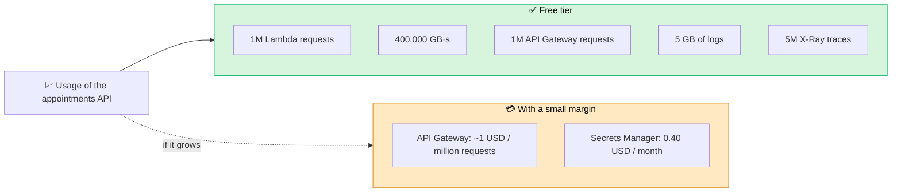
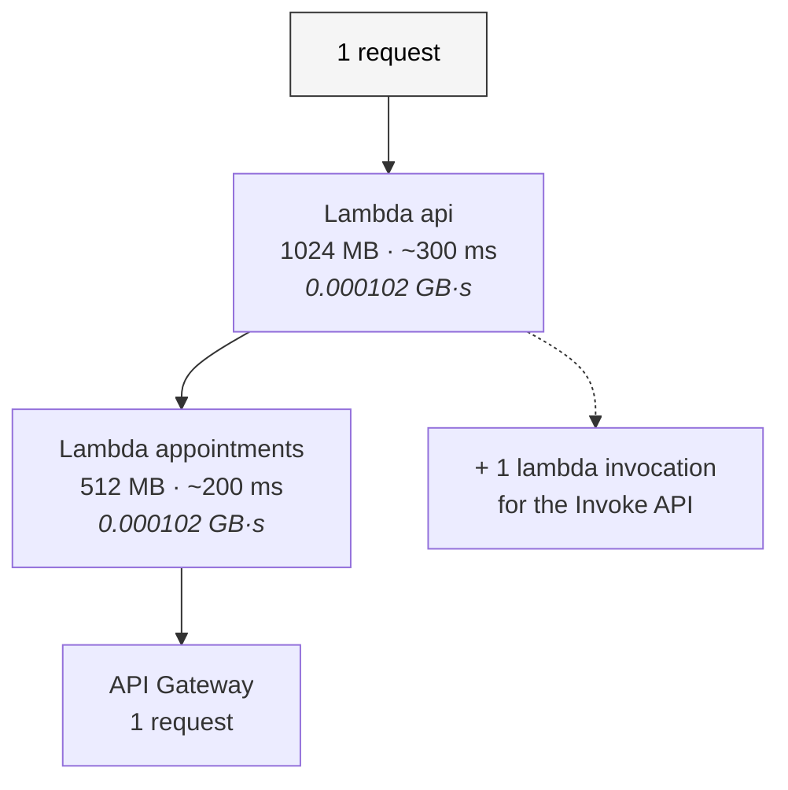
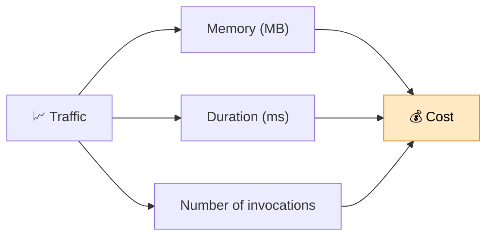
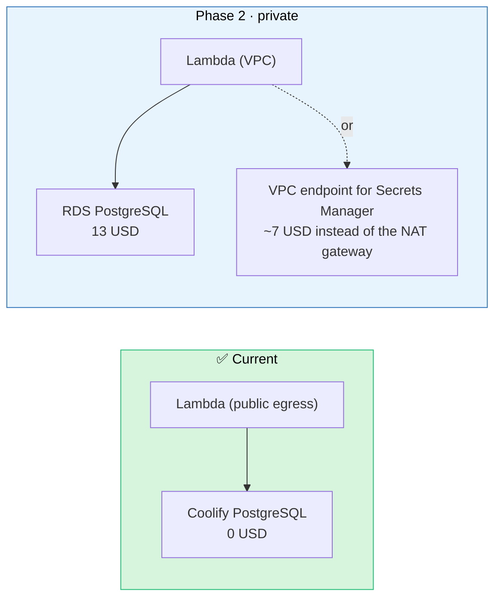

# Costs

The stack is designed to fit inside the AWS free tier. This document
estimates the cost of the deployed environment and explains how to keep it
there.

## The resources in use

| Resource | Configuration | Monthly cost |
| --- | --- | --- |
| API Gateway HTTP API | 1 API, `$default` stage, CORS | ~1 USD / million requests (the first million are free for 12 months) |
| Lambda `api` | 1024 MB, 29 s | Inside the free tier (1M requests + 400.000 GB·s per month) |
| Lambda `appointments` | 512 MB, 30 s | Inside the free tier |
| Lambda `migrate` / `seed` | 512 MB, invoked a handful of times | Negligible |
| CloudWatch Logs | 14 days of retention | Inside the free tier (5 GB/month) |
| X-Ray | 1 trace per invocation | 5 million traces free per month |
| Secrets Manager | 1 secret | 0.40 USD / month (the first one is free for 30 days) |
| PostgreSQL (Coolify) | Existing VPS | 0 USD for the project |
| **Total estimated** | | **≈ 0 USD/month** for a project of this size |



## How much does one invocation cost?



| Item | Price | Cost per request |
| --- | --- | --- |
| Lambda `api` | 0.0000166667 USD / GB·s | ~0.0000017 USD |
| Lambda `appointments` | 0.0000166667 USD / GB·s | ~0.0000009 USD |
| Lambda invocation (Invoke API) | 0.20 USD / million | 0.0000002 USD |
| API Gateway HTTP API | 1.00 USD / million | 0.0000010 USD |
| **Total** | | **≈ 0.0000038 USD** per request |

At 10.000 requests per day (300.000 per month) the Lambda and the gateway
cost about **1.15 USD/month**, and the first million requests of API Gateway
and the free tier of Lambda cover most of it.

## The levers that matter



| Lever | Current | Effect |
| --- | --- | --- |
| Memory | 512 / 1024 MB | The cost is proportional to the memory **and** the duration: more memory means a faster (and more expensive) function. 1024 MB is a good compromise for the API, which waits for the service. |
| Duration | ~300 ms (API), ~200 ms (service) | The database round trip dominates. A connection pool of 2 avoids paying the TCP handshake on every request. |
| Invocations | 2 per request | The split into two Lambdas doubles the invocations (see [ADR 0005](../decisions/0005-two-lambda-split.md)). The cost is 0.20 USD per million: negligible, and the design follows the statement. |
| Concurrency | 10 reserved | Protects the database: 10 containers × 2 connections = 20 connections. |

## What would make it expensive

| Scenario | Impact | Mitigation |
| --- | --- | --- |
| A traffic spike (a bot, a retry loop) | Thousands of invocations | The reserved concurrency caps the parallelism; the API Gateway throttle can be configured |
| Long logs | More than 5 GB per month | The retention is already set to 14 days; the sampled logs can be reduced |
| Moving to RDS in a VPC | ~13 USD/month for the instance **plus ~32 USD/month for the NAT gateway** | Use a VPC endpoint for Secrets Manager instead of a NAT gateway, or keep the database public with TLS |
| A public custom domain | ~10 USD/month for the API Gateway domain name | Not needed: the `execute-api` URL is free |

## The database

| Option | Cost | Notes |
| --- | --- | --- |
| **Coolify (current)** | 0 USD | It shares the VPS; the traffic from AWS is only a few kilobytes per request |
| RDS `db.t3.micro` | ~13 USD/month | Private, with automated backups and TLS enforced |
| RDS + NAT gateway | ~45 USD/month | The NAT gateway is what makes a VPC expensive for a serverless function |



## How to check the real cost

```bash
# the cost and usage of the last month
aws ce get-cost-and-usage \
  --time-period Start=$(date -d 'last month' +%Y-%m-01),End=$(date +%Y-%m-01) \
  --granularity MONTHLY \
  --metrics BlendedCost \
  --query 'ResultsByTime[].Metrics.BlendedCost.Amount' --output text

# the invocations of the functions
aws cloudwatch get-metric-statistics \
  --namespace AWS/Lambda \
  --metric-name Invocations \
  --dimensions Name=FunctionName,Value=appointments-dev-api \
  --start-time $(date -d '7 days ago' +%FT%TZ) --end-time $(date +%FT%TZ) \
  --period 604800 --statistics Sum
```

A **budget alarm** on the account is the safest way to notice an unexpected
bill:

```bash
aws budgets create-budget \
  --budget-name appointments-monthly \
  --budget-type COST \
  --time-unit MONTHLY \
  --budget-limit Amount=10,Unit=USD \
  --notifications-with-subscribers NotificationWithSubscribers[1].Subscribers[0].Address=team@example.com,NotificationWithSubscribers[1].NotificationType=ACTUAL,NotificationWithSubscribers[1].Subscribers[0].SubscriptionType=EMAIL
```
