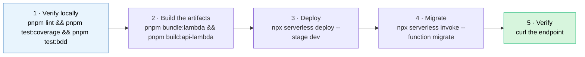
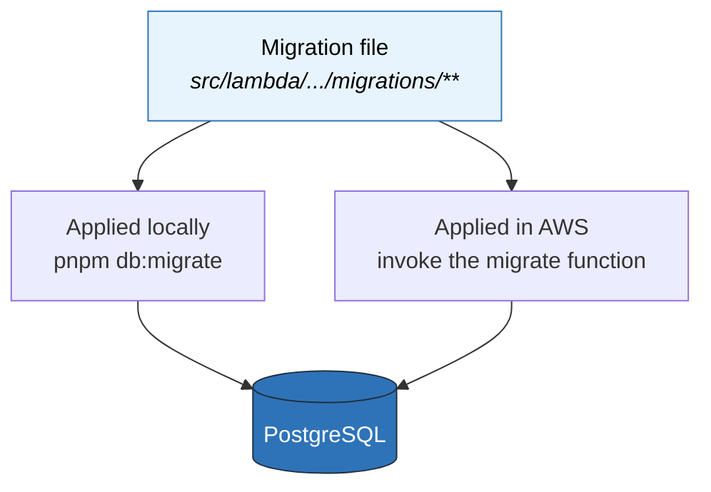
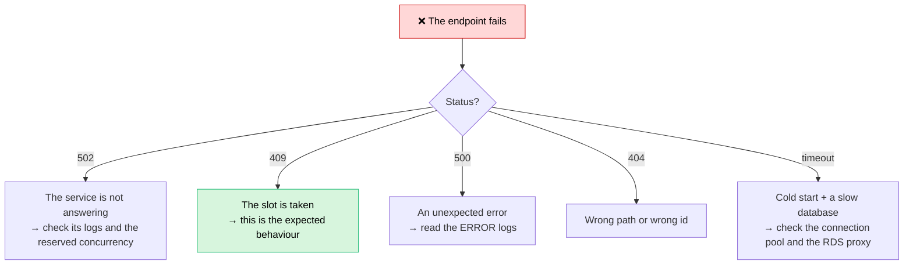
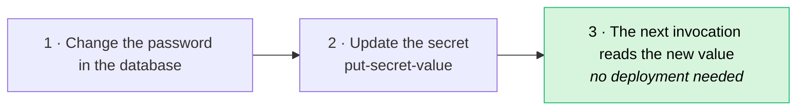
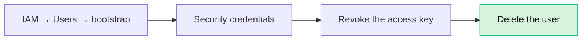

# Runbook

The operational procedures of the Appointments API.

## The environment at a glance

| Property | Value |
| --- | --- |
| Account | `550711951109` |
| Region | `us-east-1` |
| Stage | `dev` |
| Stack | `appointments-dev` |
| Endpoint | <https://5sg14jfok6.execute-api.us-east-1.amazonaws.com> |
| Documentation | <https://5sg14jfok6.execute-api.us-east-1.amazonaws.com/api/docs> |
| Database | PostgreSQL 18 in Coolify (`coolify.sdkdomains.com:5432`, database `appointments`) |
| Secret | `appointments/database-url` in AWS Secrets Manager |
| Deployment role | `arn:aws:iam::550711951109:role/appointments-deploy` (GitHub OIDC) |

## Everyday commands

```bash
export PATH="$HOME/.local/aws-cli/v2/current/bin:$PATH"

# what is deployed
aws lambda list-functions --query "Functions[?contains(FunctionName,'dev')].FunctionName" --output text
npx serverless info --stage dev --region us-east-1

# the public URL
aws cloudformation describe-stacks \
  --stack-name appointments-dev \
  --query "Stacks[0].Outputs[?OutputKey=='HttpApiUrl'].OutputValue" \
  --output text
```

## Deploying



```bash
pnpm lint && pnpm test:coverage && pnpm test:bdd

pnpm bundle:lambda && pnpm build:api-lambda
npx serverless deploy --stage dev --region us-east-1
npx serverless invoke --function migrate --stage dev --region us-east-1 --data '{}'
npx serverless invoke --function seed    --stage dev --region us-east-1 --data '{}'

curl "https://5sg14jfok6.execute-api.us-east-1.amazonaws.com/api/v1/appointments?date=2026-01-15"
```

The pipeline does exactly this automatically after the CI passes.

## Migrations



```bash
# locally
pnpm db:migrate
pnpm db:revert      # undo the last one

# in AWS
npx serverless invoke --function migrate --stage dev --data '{}'
```

The migration runner applies **only the pending** migrations and records them
in the `migrations` table, so running it twice is harmless. The pipeline
invokes it right after the deployment: if it fails, the deployment is marked
as failed.

## Seeding the demonstration data

```bash
npx serverless invoke --function seed --stage dev --data '{}'
```

The seed is idempotent (it upserts by id), so it can be run again at any time
to restore the demonstration scenario.

## Reading the logs

```bash
# the live tail of the API
aws logs tail /aws/lambda/appointments-dev-api --format short --since 10m

# the live tail of the service
aws logs tail /aws/lambda/appointments-dev-appointments --format short --since 10m

# the errors of the last hour
aws logs filter-log-events \
  --log-group-name /aws/lambda/appointments-dev-api \
  --start-time $(( ($(date +%s) - 3600) * 1000 )) \
  --filter-pattern '?ERROR'
```

The logs contain the X-Ray trace id of each invocation, which links the API
and the service in the X-Ray console.

## Troubleshooting



| Symptom | Likely cause | Action |
| --- | --- | --- |
| `502 LAMBDA_INVOCATION_FAILED` | The service timed out or is throttled | Check the logs of `appointments-dev-appointments` and the reserved concurrency (10) |
| `409 SLOT_NOT_AVAILABLE` on a free slot | The exclusion constraint found an overlap | Check the timezone of the client and `SLOT_DURATION_MINUTES` |
| The `migrate` function fails | The database is unreachable or the secret is wrong | `aws secretsmanager get-secret-value --secret-id appointments/database-url` and check the security group of the database |
| The deployment fails with `CREATE_FAILED` | A reserved environment variable was set | `AWS_REGION` is set by the runtime and cannot be overridden |
| The deployment fails with `UPDATE_ROLLBACK_COMPLETE` | A previous failed deployment is still rolling back | Wait a couple of minutes and deploy again |
| The package is rejected | The zip is too big | Check `package.patterns`: only `dist/api/**` and `dist/bundle/**` must travel |

## Rotating the database password



```bash
./scripts/create-database-secret.sh   # asks for the new password
```

The secret is read on every invocation, so the change takes effect
immediately.

## Rotating the deployment credentials

The pipeline uses **OIDC**, so there is nothing to rotate: the credentials are
temporary and the trust policy is the only thing that can be changed.

```bash
# restrict the deployments to a single branch
GITHUB_OWNER="alten-tl" GITHUB_REPO="sdet-carc" DEPLOY_BRANCHES="dev" ./scripts/bootstrap-aws.sh
```

## Revoking the bootstrap user

The `bootstrap` IAM user was only needed to create the OIDC provider and the
role. Once the pipeline works, it can be removed:



## Rolling back

```bash
git revert <sha>              # or git revert a range
git push origin dev           # the pipeline redeploys the previous code
```

The migrations are **not** reverted automatically: they are forward
compatible by design (a new column is added with a default). If a schema
revert is really needed:

```bash
pnpm db:revert                # locally, against the same database
npx serverless invoke --function migrate --stage dev --data '{}'
```

## Creating a new stage

```bash
npx serverless deploy --stage qa --region us-east-1
npx serverless invoke --function migrate --stage qa --data '{}'
```

A stage needs its own secret (`DATABASE_SECRET_NAME` overrides the default
`appointments/database-url`) if it points to a different database.

## Related documents

- [../architecture/deployment.md](../architecture/deployment.md) — the
  topology and the pipeline.
- [costs.md](costs.md) — the cost of the stack.
