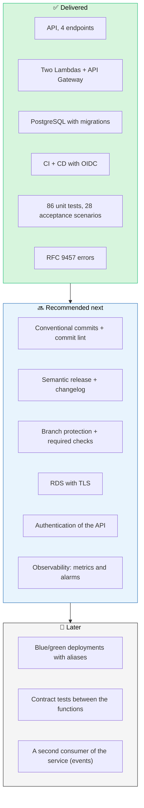
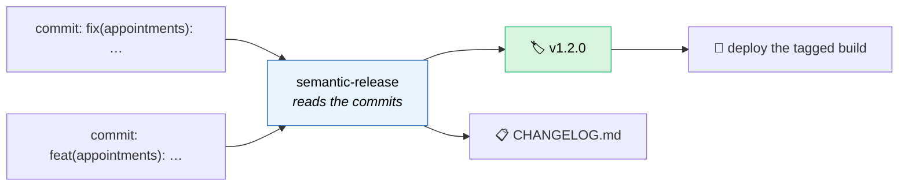
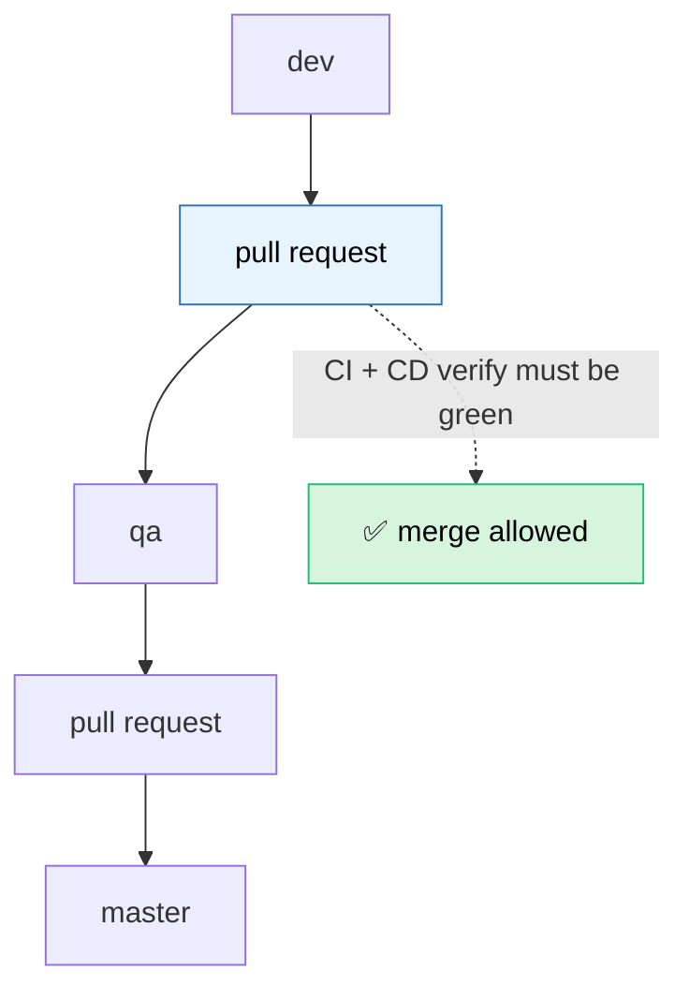
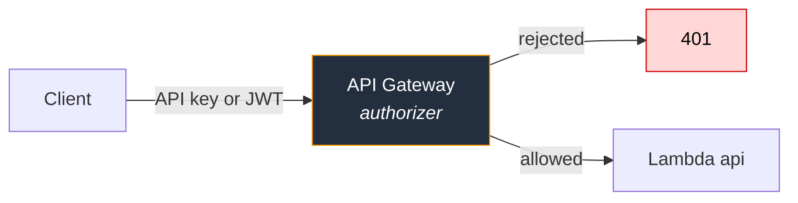
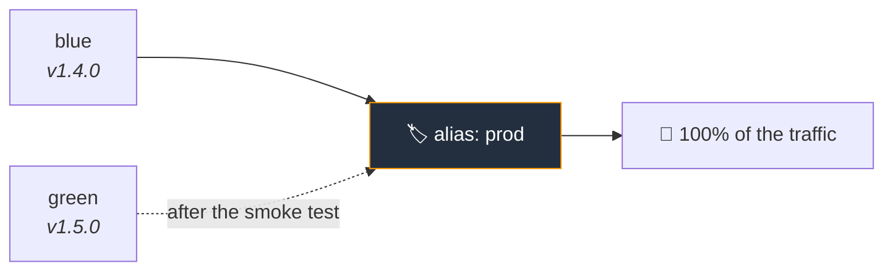

# Roadmap

What is **not** implemented yet, and how it could be done. The items are
ordered by the value they bring relative to their effort.



---

## 1. Conventional commits and a commit linter

**Problem.** The technical statement asks for the commits to follow
`[nombre-del-módulo] - Descripción corta del commit`. The repository
currently uses `scope: description` (for example
`appointment: cancel appointment`), which does not match the requested
format.

**Recommendation.** Adopt [Conventional Commits 1.0.0](https://www.conventionalcommits.org/)
and enforce it with a linter, so the convention cannot be forgotten.

```text
<type>(<scope>): <description>

feat(appointments): add the reschedule endpoint
fix(api-error-response): answer 404 when the route does not exist
docs(deployment): document the OIDC pipeline
chore(deps): bump the serverless framework to v4
```

| Type | Use |
| --- | --- |
| `feat` | A new capability |
| `fix` | A bug fix |
| `docs` | Documentation only |
| `refactor` | No behaviour change |
| `test` | Tests only |
| `chore` | Tooling, dependencies, configuration |
| `build` | The build system |
| `ci` | The pipelines |

**Implementation.**

```bash
pnpm add -D @commitlint/cli @commitlint/config-conventional husky
```

```json
// commitlint.config.js
module.exports = { extends: ['@commitlint/config-conventional'] };
```

```json
// package.json
{
  "husky": { "commit-msg": "commitlint --edit $1" },
  "scripts": { "prepare": "husky" }
}
```

**Why it matters here**

- The commits become machine readable, which is the prerequisite of the
  semantic release below.
- The module of the statement maps directly to the `scope`
  (`appointments`, `api-error-response`, `deployment`, `ci`).
- A hook that rejects a malformed message is cheaper than a review comment
  on every commit.

> If the format of the statement has to be respected literally
> (`[módulo] - Descripción`), the commitlint rules can be customised to
> validate it instead of the Conventional Commits grammar.

## 2. Semantic release and a changelog

**Problem.** There is no changelog and no version: the functions are
deployed as `$LATEST` and there is no way to know what is running in each
environment.

**Recommendation.** Use [semantic-release](https://semantic-release.gitbook.io/)
with the conventional commits of the previous section.

```bash
pnpm add -D semantic-release @semantic-release/changelog @semantic-release/npm
```

| Commit | Version | Meaning |
| --- | --- | --- |
| `fix(…):` | 1.0.1 | Patch: the API contract did not change |
| `feat(…):` | 1.1.0 | Minor: a new endpoint or a new optional field |
| `BREAKING CHANGE:` | 2.0.0 | Major: a field was removed or its type changed |

**What it would add**

- A `CHANGELOG.md` generated from the commits.
- A Git tag and a version on each release.
- The version injected in the Lambda description and in the `/api/docs`
  page, so the documentation states exactly which build is deployed.



## 3. Branch protection and required checks

**Problem.** Nothing prevents a direct push to `master`, and a merge can
happen while the CI is failing.

**Recommendation.** In the repository settings, protect `master`, `qa` and
`dev`:

| Rule | Value |
| --- | --- |
| Require a pull request | 1 approval |
| Require status checks | `CI / verify` and `CD / verify` |
| Require branches to be up to date | yes |
| Do not allow force pushes | yes |



This also matches the statement: *"Subir cambios periódicos, respetando el
tren de cambios para módulos completados"* (upload periodic changes,
respecting the change train for the completed modules).

## 4. Database in RDS with TLS

**Problem.** The PostgreSQL of Coolify does not support SSL, so the traffic
between AWS and the database is in clear text.

**Recommendation.** Migrate to RDS `db.t3.micro` in a VPC:

1. Create the instance with `require` SSL enforced by the parameter group.
2. Put the functions in the VPC (`vpcConfig` in `serverless.yml`).
3. Update the secret with the new connection string and `?sslmode=require`.
4. Apply the migrations and run the acceptance suite against the new host.

The application code does not change: it reads the connection string from the
secret. See [ADR 0010](decisions/0010-database-hosting.md).

> Watch the NAT gateway: a VPC endpoint for Secrets Manager is cheaper than
> a NAT gateway for a serverless function.

## 5. Authentication of the API

**Problem.** The endpoint is public: anybody can read and write the
appointments.

**Recommendation.** API Gateway HTTP API supports JWT authorizers and API
keys natively (a few lines in `serverless.yml`, no code change). For a
repair shop, the simplest useful option is an **API key per client** or a
JWT issued by the identity provider of the company.



## 6. Observability: metrics, alarms and dashboards

**What is there now.** X-Ray tracing on every function, the logs in
CloudWatch with a 14 day retention, and the trace id in the logs of both
functions.

**What to add.**

| Signal | Alarm |
| --- | --- |
| `5XX` rate on the API | More than 5 errors in 5 minutes |
| `Duration` p99 | More than 3 s |
| `Throttles` on the service | Any throttling (the reserved concurrency is 10) |
| `Errors` on `migrate` | Any error (the deployment failed) |
| The bill | Over 10 USD/month |

A CloudWatch dashboard with the request volume, the latency and the error
rate would make the state of the service visible at a glance.

## 7. Blue/green deployments with aliases

The functions are deployed as `$LATEST`, so a deployment replaces the code
immediately. With **aliases** (`prod`, `blue`, `green`) and a weighted
traffic shift, a bad release could be rolled back without redeploying.



## 8. Contract tests between the two functions

The contract is shared as a package and validated with Zod on both sides,
which already covers most of the risk. A **consumer driven contract** test
(a pact between the API and the service) would add the guarantee that a
change in the service cannot break the API even if the shared package is
bypassed (for example by a manual invocation with a raw payload).

## 9. Documentation of the `type` URIs

The `type` of the problem documents points to
`https://api.alten.com/problems/<slug>`. Those URLs could be served by a
static page that documents each error, turning the identifiers into real
links. It is optional: RFC 9457 does not require the URI to resolve.

## Summary

| Item | Effort | Value | Priority |
| --- | --- | --- | --- |
| Conventional commits + commitlint | 1 h | High | 🔥 |
| Semantic release + changelog | 2 h | High | 🔥 |
| Branch protection | 30 min | High | 🔥 |
| RDS with TLS | 4 h | High (security) | 🔥 |
| Metrics, alarms and dashboard | 4 h | Medium | ⭐ |
| API authentication | 3 h | High (security) | ⭐ |
| Blue/green with aliases | 4 h | Medium | ⭐ |
| Contract tests (pact) | 6 h | Low | ⭐ |
| Documentation site for the `type` URIs | 2 h | Low | ⭐ |
