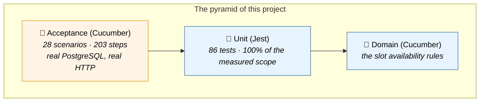
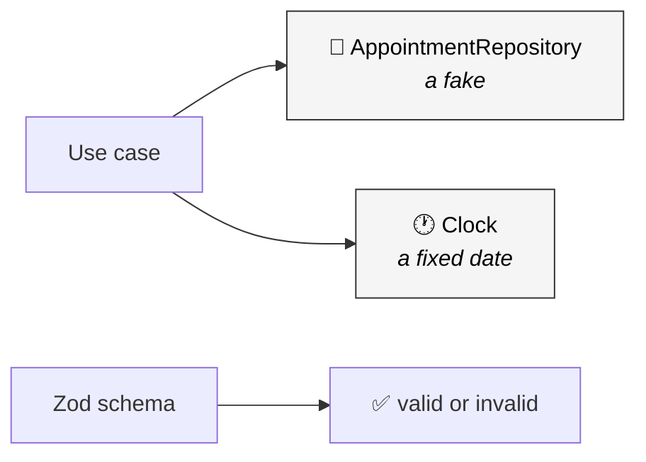
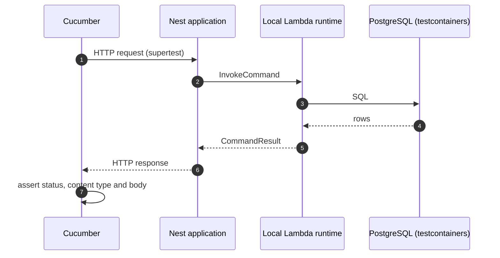
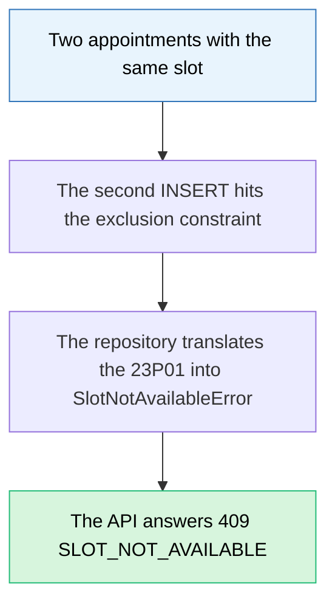
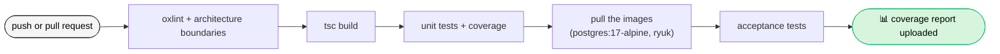

# Testing strategy

The tests are part of the architecture: they are what proves that the
contracts, the domain rules and the boundaries hold.

## What is Cucumber, in plain language

[Cucumber](https://cucumber.io/) executes **scenarios written in Gherkin**, a
small language that reads like English:

```gherkin
Scenario: Reject an appointment when the exact time slot is already taken
  Given an appointment scheduled on "2026-01-20" at "10:00"
  When the client schedules an appointment on "2026-01-20" at "10:00"
  Then the response status is 409
  And the response error code is "SLOT_NOT_AVAILABLE"
```

- **Given** is the starting situation: the data that already exists.
- **When** is the action: the request the client makes.
- **Then** is the expected result: what the client gets back.

The value for the business is that **whoever knows the rules can read and
write these scenarios**: a workshop coordinator, a product owner or a client
can check that the system behaves as agreed without reading any code. The
value for the engineering is that the same scenarios run automatically on
every push, so a rule cannot break silently.

| Suite | Scenarios | Executed against | Command |
| --- | --- | --- | --- |
| Domain BDD | `features/domain/` | The domain rules, with no infrastructure | `pnpm test:bdd:domain` |
| Acceptance BDD | `features/appointments/` | The real HTTP API, the real Lambda handler and a real PostgreSQL | `pnpm test:bdd:acceptance` |

The acceptance suite starts PostgreSQL with testcontainers, so it needs neither
a local database nor an AWS account.



## The three suites

| Suite | Command | Scope | Dependencies |
| --- | --- | --- | --- |
| Unit | `pnpm test:coverage` | Contracts, domain and use cases | None (everything is faked) |
| Domain BDD | `pnpm test:bdd:domain` | The business rules expressed as scenarios | None |
| Acceptance BDD | `pnpm test:bdd:acceptance` | The whole stack: HTTP → Lambda → PostgreSQL | PostgreSQL (testcontainers) |

```bash
pnpm test           # unit tests
pnpm test:coverage  # unit tests + coverage report
pnpm test:bdd       # domain + acceptance
pnpm test:bdd:domain
pnpm test:bdd:acceptance
```

## Unit tests



- **86 tests** covering the contracts, the domain entities, the policies and
  the use cases.
- The ports are faked, so the tests are fast (1.6 s) and deterministic: the
  clock is injected, never read from the system.
- The coverage scope is the part of the code that carries the business rules
  (`src/contracts`, `src/lambda/**/domain`, `src/lambda/**/application`) and
  it is at **100%** in the four metrics, with a threshold of 90% enforced by
  Jest.

## Domain BDD

`features/domain/slot-availability.feature` describes the rules of the slots
in the language of the business:

```gherkin
Scenario: A slot is available when no enabled appointment overlaps it
  Given an enabled appointment on "2026-01-15" at "10:00"
  When the availability of "2026-01-15" at "11:30" is checked
  Then the slot is available

Scenario: A cancelled appointment frees its slot
  Given a cancelled appointment on "2026-01-15" at "10:00"
  When the availability of "2026-01-15" at "10:00" is checked
  Then the slot is available
```

## Acceptance BDD

The acceptance suite exercises the **real** stack: the Nest application, the
AWS SDK gateway, the Lambda handler and a real PostgreSQL started with
**testcontainers** (no local database is required).



| Feature | What it covers |
| --- | --- |
| [`features/appointments/scheduling.feature`](../../features/appointments/scheduling.feature) | Create, list, reject a taken slot, reschedule, cancel |
| [`features/appointments/listing.feature`](../../features/appointments/listing.feature) | The listing by date and its empty case |
| [`features/appointments/rescheduling.feature`](../../features/appointments/rescheduling.feature) | The update of the date and the hour, and its rejections |
| [`features/appointments/cancellation.feature`](../../features/appointments/cancellation.feature) | The cancellation, the status change and the freed slot |
| [`features/appointments/slot-constraint.feature`](../../features/appointments/slot-constraint.feature) | The exclusion constraint of the database, at the repository level |
| [`features/domain/slot-availability.feature`](../../features/domain/slot-availability.feature) | The slot rules, without any infrastructure |

## The concurrency guarantee

The most important test is the one that proves the **double booking is
impossible**. A timing based test is not reliable (the check takes ~1.5 ms
and the jitter between two parallel requests is ~3 ms, so the pre-check
almost always wins the race), so the constraint is tested **directly at the
repository level**:



The test was verified to **have teeth**: with the translation removed, it
fails with `Expected DomainError, Received QueryFailedError`.

## The CI



The pipeline pulls the container images **before** running the acceptance
tests. Without that step, a cold runner spent most of its 15 minutes pulling
`postgres:17-alpine` and the testcontainers helper, and the job was killed by
the timeout. With the pre-pull, the whole suite takes **3.4 seconds**.

The setup has a generous timeout (`SETUP_TIMEOUT = 180 s`) and a safety net
(`FORCE_EXIT_TIMEOUT = 30 s`) that stops a pending container if the setup
fails, so a broken environment never leaves orphan containers behind.

## Architecture boundaries

The boundaries are tested by the linter, not by the tests:

```bash
pnpm lint        # oxlint + src/tools/check-boundaries.ts
```

Any import that breaks the layer rules fails the CI.

## Related documents

- [../architecture/overview.md](../architecture/overview.md) — the layers.
- [ADR 0006](../decisions/0006-postgresql-and-exclusion-constraint.md) — the
  constraint that the acceptance suite verifies.
